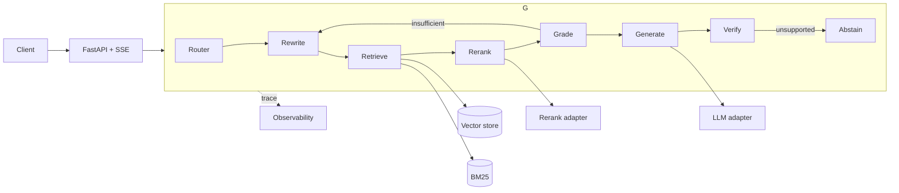

# O.W.L. Online

A grounded, agentic RAG application - a revision tool that answers questions, generates practice exams, and grades your answers.

> Status: early. The engine (retrieval -> grounded generation -> evaluation) is under construction. See the milestones and issues.

---

## What it is

O.W.L. Online is a grounded question-answering engine with three surfaces on one core:

| Mode | What it does |
|---|---|
| Revision chat | Ask anything, get a grounded answer with citations |
| Exam mode | Generate practice O.W.L. / N.E.W.T. questions by subject |
| Grading | Grade your answers on the O.W.L. scale: O / E / A / P / D / T |

The corpus is a single well-known work of fiction. The source text is not included (see Disclaimer). The point of the project is not the corpus - it is the evaluation discipline and the full-stack agent around it.

---

## Why it exists

A portfolio project that does the two hard things, then wraps them in a served application:

1. A retrieval core that works - hybrid (dense + BM25, fused with RRF) then rerank.
2. An evaluation harness that separates failures - retrieval scored on chunk ids, generation scored by a judge, plus a closed-book control and perturbation probes.

---

## Architecture

Every model call goes through an adapter, so the provider is a config value, not an architecture.

---

## Evaluation

The harness scores each stage separately, so a failure can be attributed to retrieval or generation.

| Layer | Metric | Gate |
|---|---|---|
| Retrieval | `Hit@k` / `Recall@k` / `MRR` | no regression |
| Generation | judge correctness, faithfulness | thresholds |
| Grounding | citation validity | `= 1.0` |
| Abstention | refusal on `unanswerable` | high |
| Leakage | closed-book gap | augmented >> closed-book |

---

## Roadmap

- M1 Package the pipeline
- M2 Eval harness as CI gate
- M3 Single-shot streaming API
- M4 Grounding and guardrails
- M5 Agentic loop (LangGraph)
- M6 Observability and deploy
- M7 Exam mode
- Future: lesson mode (a virtual professor)

---

## Tech

`Python` - `FastAPI` - `LangGraph` - hybrid retrieval (vector + BM25 + RRF) - LLM adapters - eval-as-CI

---

## Agent workflow

This repository is developed with AI coding agents under human review.

- `AGENTS.md` gives coding agents project guidance: build, test, conventions, verification.
- A read-only reviewer subagent (`.opencode/agents/reviewer.md`) reviews each ticket against its acceptance criteria before it is done.
- The GitHub MCP server is used to read issues and post review findings back to the ticket.

---

## AI usage

This project is developed with AI coding agents under human review, and that usage is recorded per ticket.

- AI drafted parts of the code: for ticket #1, the factory (`app/providers/factory.py`) and parts of the test suite were agent-written; the contracts and schemas were human-written with agent review. The human reviewed, tested, and owns every line.
- The system design and architecture decisions (contracts, provider abstraction, eval discipline) are human-directed; the AI assistant advised and explained, the human decided.
- AI also drafted documentation (this README, issue descriptions).

Per-ticket records live in the commit history (`(#N)` suffixes) and pull request descriptions.

---

## Disclaimer

The source corpus is copyrighted and is not included in this repository. Only original code, questions, and metrics are published. This is a personal, non-commercial study project.
