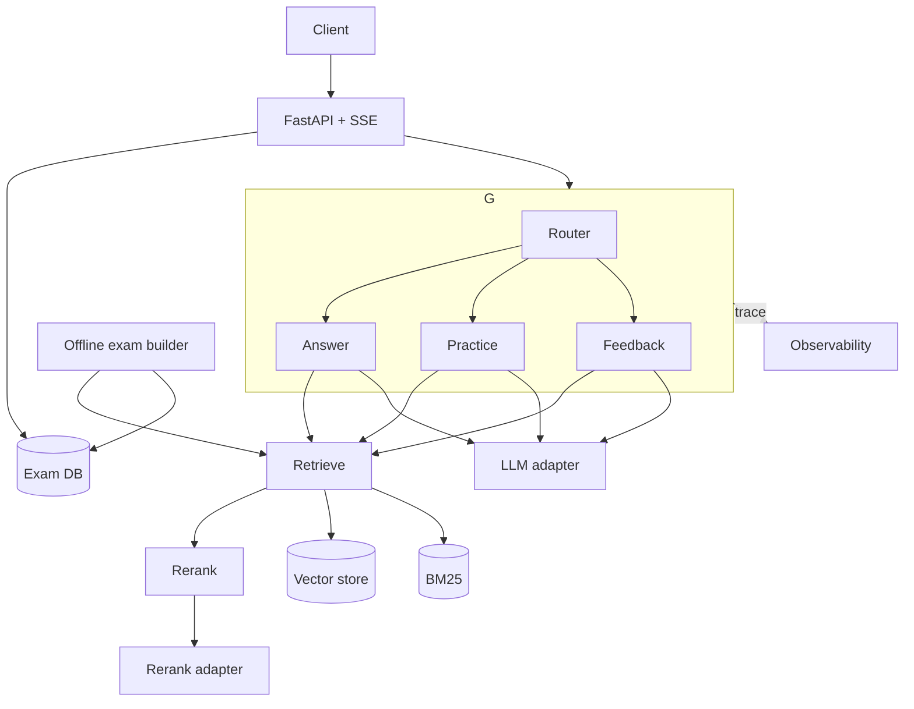

# O.W.L. Online

A grounded, agentic RAG application - a revision tool that answers questions, runs conversational practice, and serves pre-generated exams with hybrid grading.

> Status: V1 shipped. The V2 chat foundation is delivered: guardrails, LangGraph chat, cost controls, the local eval gate and the deterministic PR CI gate (#16). The retrieval foundation (#96) and the held-out set (#106) are complete. The multi-book answer path (#105) is merged but flag-off; it is a time-boxed spike. Current focus is the thin professor slice (#97) and the required-check setting. V2.5 is the exam bank with hybrid grading. Grounded RAG is live at https://api.monitus.org. See [`docs/workplan.md`](docs/workplan.md) and the milestones.

---

## What it is

O.W.L. Online has two product surfaces on one retrieval core:

| Surface | What it does | State |
|---|---|---|
| Chat answer | Grounded Q&A with citations | live |
| Chat practice | On-demand grounded practice question | live |
| Chat feedback | Formative feedback and a provisional mark | live |
| Exam bank | Pre-generated 10-question papers stored in a DB, served statically, graded by a hybrid scorer | planned V2.5 |
| Lesson mode | A future chat intent | future iteration |

Chat practice and feedback are ephemeral and formative. The exam bank is the
authoritative surface: papers are generated offline, validated, versioned and
stored. Objective answers are scored deterministically; free-text answers are
judged by a pinned LLM against the stored rubric and evidence snapshot; totals
and score bands are deterministic.

See [`docs/workplan.md`](docs/workplan.md) for the phase plan, ticket map and
grading decisions.

The exam bank is not a request-time generator. A batch job produces a paper and
its rubric, validates both, and stores them. Each question keeps an evidence
snapshot so regrading stays reproducible after an index rebuild. A paper is 10
questions by default: a mix of objective, short-answer and long-answer items.
Objective answers are scored by code; long answers go to a pinned judge with the
rubric and evidence. The judge never writes the final total or band.

Exam generation and lesson mode read from versioned subject knowledge packs:
one grounded material store per O.W.L. subject, with every material linked to a
book chunk, quote and text hash. A question or lesson section that cannot cite a
pack material is rejected before publication. External references such as the
Harry Potter Lexicon are stored as attributed links for discovery and
cross-checking; they are not copied into the packs and are not the canonical
source.

Core exam content uses the seven novels. Rowling companion books and interviews
are optional further reading, not exam-gradable in the first version. Films,
games and fan works are excluded from the set texts.

Chat is the variable-cost surface. Messages are capped per session and per IP,
with a concurrency limit, an exact cache for repeated questions, per-request
usage and cost logs, and a daily token budget that degrades chat before it can
exhaust the spend.

The corpus is a single well-known work of fiction. The source text is not included (see Disclaimer). The point of the project is not the corpus - it is the evaluation discipline and the full-stack agent around it.

---

## Why it exists

A portfolio project that does the two hard things, then wraps them in a served application:

1. A retrieval core that works - hybrid (dense + BM25, fused with RRF) then rerank.
2. An evaluation harness that separates failures - retrieval scored on chunk ids, generation scored by a judge, plus a closed-book control and perturbation probes.

---

## Architecture



Every model call goes through an adapter, so the provider is a config value, not an architecture.

See [`docs/architecture.md`](docs/architecture.md) for the current contracts, module dependencies, and the `/ask` and `/ask/stream` request flows. The exam-bank pipeline is planned and documented there as a separate boundary, not as a chat intent.

---

## Run

```
uv sync
uv run python scripts/build_index.py                 # once: build the vector index
OWL_PROVIDER=openrouter uv run uvicorn app.main:app --reload
# or the Bedrock Converse path, using an in-region open-weight model:
OWL_PROVIDER=bedrock OWL_BEDROCK_LLM_MODEL=qwen.qwen3-32b-v1:0 \
  uv run uvicorn app.main:app --reload
```

Needs an `OWL_OPENROUTER_API_KEY` and an Ollama daemon for embeddings; for cloud,
set `OWL_EMBEDDER_PROVIDER=bedrock` (Amazon Titan) instead, so no daemon is
needed, and build the index with that embedder. Reranking uses Bedrock
`amazon.rerank-v1:0` and needs AWS credentials; set `OWL_RERANK_PROVIDER=none` to
run without AWS. `OWL_PROVIDER=bedrock` uses `BedrockLlm` over the Converse API;
probe the configured model once with
`uv run python scripts/probe_bedrock.py`. Copy `.env.example` to `.env` and fill
it in. For containers and hosting, see [`docs/deploy.md`](docs/deploy.md).

The chat page uses `POST /ask/stream`. To watch the raw SSE events:

```
curl -N -X POST http://localhost:8000/ask/stream \
  -H 'Content-Type: application/json' \
  -d '{"question":"Who is the Head of Gryffindor House?"}'
```

---

## Evaluation

The harness scores each stage separately, so a failure can be attributed to retrieval or generation.

| Layer | Metric | Gate |
|---|---|---|
| Retrieval | `Hit@k` / `Recall@k` / `MRR` | no regression |
| Generation | judge correctness, faithfulness | thresholds |
| Grounding | citation validity | `= 1.0` |
| Abstention | refusal on `unanswerable` | high |
| Leakage | closed-book gap | augmented >> closed-book |

First measured run (V1 mini-eval #51, reranker #6; details in `eval/README.md`):

| Metric | With rerank | No rerank |
|---|---|---|
| Hit@5 | 0.70 | 0.60 |
| Recall@5 | 0.53 | 0.42 |
| MRR | 0.45 | 0.45 |
| Abstention on unanswerable | 1.00 | 1.00 |
| Judge correct / partial / wrong | 9 / 0 / 0 of 10 | 7 / 1 / 2 of 10 |
| Grounded | 9 / 10 | 8 / 10 |

Current pinned baseline (`20261106T060737Z`, quota 0; canonical record: `docs/runs/2026-11-06-v2-quota-baseline.md`):

| Metric | Value |
|---|---:|
| Hit@5 overall | 0.76 |
| Hit@5 multi-part | 0.67 |
| Hit@5 named reference | 1.00 |
| Judge correct | 13/14 |
| Faithful | 13/14 |
| Abstention on unanswerable | 10/10 |

The aggregation fixture adds cross-book coverage: book coverage 0.46, entity completeness 0.45, full coverage 0.00. The routed per-book prototype reaches 0.79 coverage and 0.76 completeness at equal k=7, but citation validity is 0.56 and it is not wired into chat yet. The router separates all 10 multi-book items from the 5 near-misses on the fixture, in-sample.

Generator `qwen/qwen3-30b-a3b-instruct-2507`; judge `deepseek/deepseek-v4.1-flash-1017` (different family); reranker `amazon.rerank-v1:0`. The pinned configuration (model slugs, chunking, `top_k`, `rrf_k`, pool) is in [`config/manifest.toml`](config/manifest.toml). The eval reads the judge slug from it, and `eval/test_manifest.py` asserts the code's pinned defaults agree, so the gate fails on drift.

Every finished eval run also gets a committed Markdown record under [`docs/runs/`](docs/runs/README.md): run id, configuration, per-slice tables, reading notes, and the raw summary. The record is the strategy history; timestamped CSVs stay local.

---

## Roadmap

The full vision (bottom-up): a packaged pipeline, an eval harness and local gate,
a streaming API, grounding guardrails, an agentic loop, observability and deploy,
and a static exam bank. The deterministic PR CI gate is in place; the live gate
runs on the host because the corpus is not in git.

Execution is phased:

| Phase | Scope | Status |
|---|---|---|
| V1 - Shippable | grounded RAG end-to-end: ingest, hybrid retrieval + rerank, cited generation with abstention, API, mini-eval, deployed | shipped (https://api.monitus.org) |
| V2 - Deepening | guardrails, chat intents (LangGraph), Bedrock Llm adapter, cost controls, local eval gate, retrieval foundation, multi-book answer path, professor persona | chat foundation, retrieval foundation, held-out set and deterministic CI gate delivered; #105 flag-off and time-boxed; #97 next |
| V2.5 - Exam bank | subject knowledge packs, offline 10-question papers, evidence snapshots, static serving, hybrid grading, grading eval | after #105 and #97 |
| V3 - Continuity | short-term chat memory, threads, follow-up rewrite, lesson mode | after V2.5 |
| V4 - Identity (optional) | Google auth, per-user chat and exam history, progress tracking, long-term memory | last, if needed |

---

## Tech

`Python` - `FastAPI` - `LangGraph` - hybrid retrieval (vector + BM25 + RRF) + rerank - LLM adapters - eval harness and local gate; deterministic PR CI gate

---

## Agent workflow

This repository is developed with AI coding agents under human review.

- `AGENTS.md` gives coding agents project guidance: build, test, conventions, verification.
- A read-only reviewer subagent (`.opencode/agents/reviewer.md`) reviews each ticket against its acceptance criteria before it is done.
- The GitHub MCP server is used to read issues and post review findings back to the ticket.

---

## AI usage

This project is developed with AI coding agents under human review, and that usage is recorded per ticket.

- AI drafted parts of the code: for ticket #1, the factory (`app/providers/factory.py`) and parts of the test suite were agent-written; the contracts and schemas were human-written with agent review. For ticket #49, the OpenRouter adapter (`app/providers/openrouter.py`), the probe logic (`app/providers/probe.py`), the grounded `ask()` path (`app/pipeline/generate/generate.py`) and their tests were agent-drafted. For ticket #50, the API composition root (`app/api/runtime.py`), schemas, the `/ask` endpoint and static chat page (`app/main.py`, `app/api/static/index.html`) and the API tests were agent-drafted. For ticket #51, the mini-eval harness and gold set (`eval/`) and the eval runner were agent-drafted. For ticket #6, the Bedrock reranker (`app/providers/bedrock.py`) and the two-stage retrieval wiring were agent-drafted. For ticket #52, the Dockerfile, the deploy guide (`docs/deploy.md`), the deploy workflow (`.github/workflows/deploy.yml`), the Titan embedder, the concurrent retrieval change, and the logging (`app/logging.py`, request ids and per-stage timings) were agent-drafted. Follow-ups to #52 (the rollout disk fix and the dependency split that slimmed the image to about 215 MB) were agent-drafted. For ticket #53, the repro manifest (`config/manifest.toml`), the manifest test (`eval/test_manifest.py`), and this README were agent-drafted. For ticket #76, the eval harness split (`eval/harness/`), result CSV and baseline diff (`eval/results.py`), run orchestration (`eval/runner.py`, `eval/report.py`, `eval/check.py`), the expanded gold set, the run-record docs and their tests were agent-drafted. For ticket #77, the threshold file, gate logic, exit code, gate tests, temperature pinning and the cache variant were agent-drafted. For ticket #78, the retrieval diagnostics, metadata filter, question decomposition, gold audit, contextual-retrieval experiment, embedder override and their tests and run records were agent-drafted. For ticket #80, the Bedrock Converse Llm adapter, LangGraph state, chat-intent router, answer/practice/feedback nodes, SSE endpoint, chat-page stream reader, probe script and their tests were agent-drafted. For ticket #81, the deterministic verifier (`app/pipeline/generate/verify.py`), the bounded retry in `ask()`, the SSE reset wiring, the cache replay tool and the D5 tests and run records were agent-drafted. The human decided that a deliberate refusal is final and that practice and feedback stay out of the retry loop. For ticket #79, the tokenizer ablation, the rerank-floor measurement, the novel-entity signal, the `/ask` deadline and their tests were agent-drafted. For ticket #88, the in-process rate limiter, exact answer cache, usage accounting, spend guard, API wiring and their tests were agent-drafted. The human chose the limit defaults and the degradation policy. For ticket #82, the request tracer, evidence injection guard, instrumentation and tests were agent-drafted. The human decided to reject stemming and to keep the floor at zero on the evidence. The D6 run record and the `eval/README.md` experiment sections were agent-drafted. The human decided the rule-based router and reviewed, tested, and owns every line. The scope boundary between chat intents and the offline exam bank was human-directed. For ticket #96, the sub-query quota, the trace fix, the reranker pool cap and their tests were agent-drafted; the human kept the quota opt-in until a larger sample measures it. For ticket #106, the held-out fixture, records, shape test and README section were agent-drafted; the human froze the set before tuning. For ticket #105, the multi-book answer path, extraction prompts, coverage statement and tests were agent-drafted; the human reviewed the live smoke and kept the path behind OWL_MULTI_BOOK. For ticket #16, the eval workflow (`.github/workflows/eval.yml`) and the CI documentation were agent-drafted; the human kept the live gate host-side and made the check required. For ticket #97, the persona card (`config/persona.toml`, `docs/persona.md`), the scripted meta and personal nodes, the lore schema and the thin-slice tests were agent-drafted; the human set the DADA-first scope, the official letter grades and the no-house school.
- The system design and architecture decisions (contracts, provider abstraction, eval discipline) are human-directed; the AI assistant advised and explained, the human decided.
- AI also drafted documentation (this README, issue descriptions).

Per-ticket records live in the commit history (`(#N)` suffixes) and pull request descriptions.

---

## Disclaimer

The source corpus is copyrighted and is not included in this repository. Only original code, questions, and metrics are published. This is a personal, non-commercial study project.
