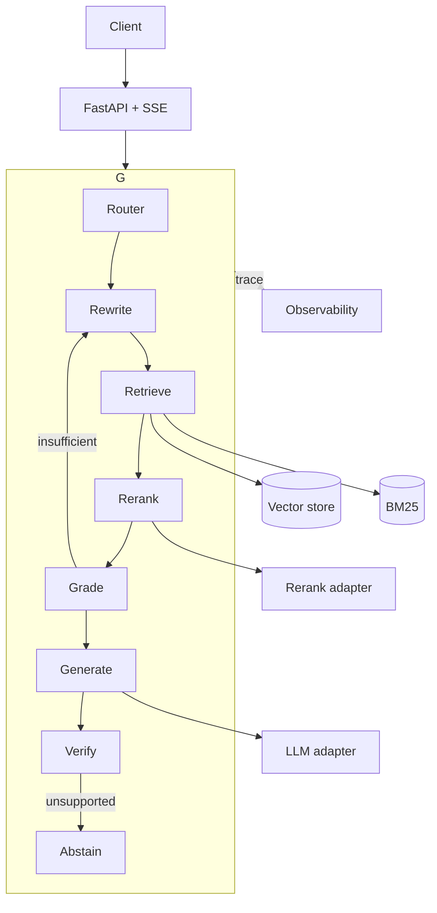

# O.W.L. Online

A grounded, agentic RAG application - a revision tool that answers questions, generates practice exams, and grades your answers.

> Status: early. The engine (retrieval -> grounded generation -> evaluation) is under construction. See the milestones and issues.

---

## What it is

O.W.L. Online is a grounded question-answering engine with three surfaces on one core:

| Mode | What it does | Priority |
|---|---|---|
| Revision chat | Ask anything, get a grounded answer with citations | MVP item 1 (Highest Priority) |
| Exam mode | Generate practice O.W.L. / N.E.W.T. questions by subject | MVP item 2 |
| Grading | Grade your answers on the O.W.L. scale: O / E / A / P / D / T | MVP item 3 |
| Lesson mode | Generate a lesson plan with questions and answers | Future iteration |

The corpus is a single well-known work of fiction. The source text is not included (see Disclaimer). The point of the project is not the corpus - it is the evaluation discipline and the full-stack agent around it.

---

## Why it exists

A portfolio project that does the two hard things, then wraps them in a served application:

1. A retrieval core that works - hybrid (dense + BM25, fused with RRF) then rerank.
2. An evaluation harness that separates failures - retrieval scored on chunk ids, generation scored by a judge, plus a closed-book control and perturbation probes.

---

## Architecture

Every model call goes through an adapter, so the provider is a config value, not an architecture.

See [`docs/architecture.md`](docs/architecture.md) for the V1 contracts, module dependencies, and the `/ask` request flow. The diagram above is the full V1-V3 vision; that page is what is built today.

---

## Evaluation

The harness scores each stage separately, so a failure can be attributed to retrieval or generation.

| Layer | Metric | Gate |
|---|---|---|
| Retrieval | `Hit@k` / `Recall@k` / `MRR` | no regression |
| Generation | judge correctness, faithfulness | thresholds |
| Grounding | citation validity | `= 1.0` |
| Abstention | refusal on `unanswerable` | high |
| Leakage | closed-book gap | augmented >> closed-book |

First measured run (V1 mini-eval, #51; details in `eval/README.md`):

| Metric | Value |
|---|---|
| Hit@5 | 0.60 |
| Recall@5 | 0.42 |
| MRR | 0.45 |
| Abstention on unanswerable | 1.00 |
| Judge correct / partial / wrong | 7 / 1 / 2 of 10 |
| Grounded | 8 / 10 |

Generator `qwen/qwen3-30b-a3b-instruct-2507`; judge `deepseek/deepseek-v4.1-flash-1017` (different family).

---

## Roadmap

The full vision (bottom-up): a packaged pipeline, an eval harness as a CI gate,
a streaming API, grounding guardrails, an agentic loop, observability and deploy,
and an exam mode.

Execution is phased:

| Phase | Scope | Status |
|---|---|---|
| V1 - Shippable | grounded RAG end-to-end: ingest, hybrid retrieval + rerank, cited generation with abstention, API, mini-eval, deployed | in progress (one-week sprint, issues #6, #47-#53) |
| V2 - Deepening | guardrails, agentic loop (LangGraph), Bedrock adapter, full eval harness as CI gate | planned |
| V3 - Product | exam mode, lesson mode | Exam mode priority, lesson mode in the future |

---

## Tech

`Python` - `FastAPI` - `LangGraph` - hybrid retrieval (vector + BM25 + RRF) - LLM adapters - eval-as-CI

---

## Agent workflow

This repository is developed with AI coding agents under human review.

- `AGENTS.md` gives coding agents project guidance: build, test, conventions, verification.
- A read-only reviewer subagent (`.opencode/agents/reviewer.md`) reviews each ticket against its acceptance criteria before it is done.
- The GitHub MCP server is used to read issues and post review findings back to the ticket.

---

## AI usage

This project is developed with AI coding agents under human review, and that usage is recorded per ticket.

- AI drafted parts of the code: for ticket #1, the factory (`app/providers/factory.py`) and parts of the test suite were agent-written; the contracts and schemas were human-written with agent review. For ticket #49, the OpenRouter adapter (`app/providers/openrouter.py`), the probe logic (`app/providers/probe.py`), the grounded `ask()` path (`app/pipeline/generate/generate.py`) and their tests were agent-drafted. For ticket #50, the API composition root (`app/api/runtime.py`), schemas, the `/ask` endpoint and static chat page (`app/main.py`, `app/api/static/index.html`) and the API tests were agent-drafted. For ticket #51, the mini-eval harness and gold set (`eval/`) and the eval runner were agent-drafted. For ticket #6, the Bedrock reranker (`app/providers/bedrock.py`) and the two-stage retrieval wiring were agent-drafted. The human reviewed, tested, and owns every line.
- The system design and architecture decisions (contracts, provider abstraction, eval discipline) are human-directed; the AI assistant advised and explained, the human decided.
- AI also drafted documentation (this README, issue descriptions).

Per-ticket records live in the commit history (`(#N)` suffixes) and pull request descriptions.

---

## Disclaimer

The source corpus is copyrighted and is not included in this repository. Only original code, questions, and metrics are published. This is a personal, non-commercial study project.
