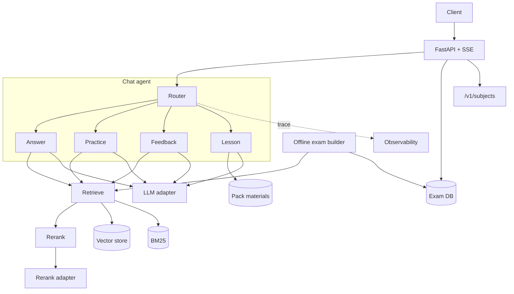

# O.W.L. Online

A grounded, agentic RAG application - a revision tool that answers questions, runs conversational practice, and serves pre-generated exams with hybrid grading.

> Status: grounded chat, the DADA pack published at 1.0.0, and the professor persona live behind `OWL_PERSONA`. Lesson mode is implemented behind `OWL_LESSON_MODE` and needs the pack on the host volume. The academy frontend ships from `web/` on Cloudflare Pages, and the API is at https://api.monitus.org. Lesson answers cite reviewed materials and their book source refs; a missing pack falls back to labelled corpus chat. The next product surface is the exam bank with hybrid grading, plus mixed-scope answers, conversation memory and a second department. See [`docs/workplan.md`](docs/workplan.md), [`docs/api.md`](docs/api.md), [`web/README.md`](web/README.md) and the milestones.

---

## What it is

O.W.L. Online has two product surfaces on one retrieval core:

| Surface | What it does | State |
|---|---|---|
| Chat answer | Grounded Q&A with citations | live |
| Chat practice | On-demand grounded practice question | live |
| Chat feedback | Formative feedback and a provisional mark | live |
| Exam bank | Pre-generated 10-question papers stored in a DB, served statically, graded by a hybrid scorer | planned V3 (#178) |
| Lesson mode | Pack-grounded teaching answers with material and book citations | implemented behind `OWL_LESSON_MODE`; needs the pack on the host volume |

Chat practice and feedback are ephemeral and formative. The exam bank is the
authoritative surface: papers are generated offline, validated, versioned and
stored. Objective answers are scored deterministically; free-text answers are
judged by a pinned LLM against the stored rubric and evidence snapshot; totals
and score bands are deterministic.

See [`docs/workplan.md`](docs/workplan.md) for the phase plan, ticket map and
grading decisions.

The exam bank is not a request-time generator. A batch job produces a paper and
its rubric, validates both, and stores them. Each question keeps an evidence
snapshot so regrading stays reproducible after an index rebuild. A paper is 10
questions by default: a mix of objective, short-answer and long-answer items.
Objective answers are scored by code; long answers go to a pinned judge with the
rubric and evidence. The judge never writes the final total or band.

Exam generation and lesson mode read from versioned subject knowledge packs:
one grounded material store per O.W.L. subject, with every material linked to a
book chunk, quote and text hash. A question or lesson section that cannot cite a
pack material is rejected before publication. External references such as the
Harry Potter Lexicon are stored as attributed links for discovery and
cross-checking; they are not copied into the packs and are not the canonical
source.

Core exam content uses the seven novels. Rowling companion books and interviews
are optional further reading, not exam-gradable in the first version. Films,
games and fan works are excluded from the set texts.

Chat is the variable-cost surface. Messages are capped per session and per IP,
with a concurrency limit, an exact cache for repeated questions, per-request
usage and cost logs, and a daily token budget that degrades chat before it can
exhaust the spend.

The corpus is a single well-known work of fiction. The source text is not included (see Disclaimer). The point of the project is not the corpus - it is the evaluation discipline and the full-stack agent around it.

---

## Why it exists

A portfolio project that does the two hard things, then wraps them in a served application:

1. A retrieval core that works - hybrid (dense + BM25, fused with RRF) then rerank.
2. An evaluation harness that separates failures - retrieval scored on chunk ids, generation scored by a judge, plus a closed-book control and perturbation probes.

---

## Architecture



Every model call goes through an adapter, so the provider is a config value, not an architecture.

See [`docs/architecture.md`](docs/architecture.md) for the current contracts, module dependencies, and the `/ask` and `/ask/stream` request flows. The exam-bank pipeline is planned and documented there as a separate boundary, not as a chat intent.

---

## Run

```
uv sync
uv run python scripts/build_index.py                 # once: build the vector index
OWL_PROVIDER=openrouter uv run uvicorn app.main:app --reload
# or the Bedrock Converse path, using an in-region open-weight model:
OWL_PROVIDER=bedrock OWL_BEDROCK_LLM_MODEL=qwen.qwen3-32b-v1:0 \
  uv run uvicorn app.main:app --reload
```

Needs an `OWL_OPENROUTER_API_KEY` and an Ollama daemon for embeddings; for cloud,
set `OWL_EMBEDDER_PROVIDER=bedrock` (Amazon Titan) instead, so no daemon is
needed, and build the index with that embedder. Reranking uses Bedrock
`amazon.rerank-v1:0` and needs AWS credentials; set `OWL_RERANK_PROVIDER=none` to
run without AWS. `OWL_PROVIDER=bedrock` uses `BedrockLlm` over the Converse API;
probe the configured model once with
`uv run python scripts/probe_bedrock.py`. Copy `.env.example` to `.env` and fill
it in. For containers and hosting, see [`docs/deploy.md`](docs/deploy.md).

The chat page uses `POST /ask/stream`. To watch the raw SSE events:

```
curl -N -X POST http://localhost:8000/ask/stream \
  -H 'Content-Type: application/json' \
  -d '{"question":"Who is the Head of Gryffindor House?"}'
```

---

## Evaluation

The harness scores each stage separately, so a failure can be attributed to retrieval or generation.

| Layer | Metric | Gate |
|---|---|---|
| Retrieval | `Hit@k` / `Recall@k` / `MRR` | no regression |
| Generation | judge correctness, faithfulness | thresholds |
| Grounding | citation validity | `= 1.0` |
| Abstention | refusal on `unanswerable` | high |
| Leakage | closed-book gap | augmented >> closed-book |

First measured run (V1 mini-eval #51, reranker #6; details in `eval/README.md`):

| Metric | With rerank | No rerank |
|---|---|---|
| Hit@5 | 0.70 | 0.60 |
| Recall@5 | 0.53 | 0.42 |
| MRR | 0.45 | 0.45 |
| Abstention on unanswerable | 1.00 | 1.00 |
| Judge correct / partial / wrong | 9 / 0 / 0 of 10 | 7 / 1 / 2 of 10 |
| Grounded | 9 / 10 | 8 / 10 |

Current pinned baseline (`20261106T214850Z`, quota 0; canonical record: `docs/runs/2026-11-07-113-ingest-rebaseline.md`):

| Metric | Value |
|---|---:|
| Hit@5 overall | 0.76 |
| Hit@5 multi-part | 0.67 |
| Hit@5 named reference | 1.00 |
| Judge correct | 13/15 |
| Faithful | 13/15 |
| Abstention on unanswerable | 10/10 |

The aggregation fixture adds cross-book coverage: book coverage 0.46, entity completeness 0.45, full coverage 0.00. The routed per-book prototype reaches 0.79 coverage and 0.76 completeness at equal k=7, but citation validity is 0.56 and it is not wired into chat yet. The router separates all 10 multi-book items from the 5 near-misses on the fixture, in-sample.

Generator `qwen/qwen3-30b-a3b-instruct-2507`; judge `deepseek/deepseek-v4.1-flash-1017` (different family); reranker `amazon.rerank-v1:0`. The pinned configuration (model slugs, chunking, `top_k`, `rrf_k`, pool) is in [`config/manifest.toml`](config/manifest.toml). The eval reads the judge slug from it, and `eval/test_manifest.py` asserts the code's pinned defaults agree, so the gate fails on drift.

Every finished eval run also gets a committed Markdown record under [`docs/runs/`](docs/runs/README.md): run id, configuration, per-slice tables, reading notes, and the raw summary. The record is the strategy history; timestamped CSVs stay local.

---

## Roadmap

The full vision (bottom-up): a packaged pipeline, an eval harness and local gate,
a streaming API, grounding guardrails, an agentic loop, observability and deploy,
and a static exam bank. The deterministic PR CI gate is in place; the live gate
runs on the host because the corpus is not in git.

Execution is phased:

| Phase | Scope | Status |
|---|---|---|
| V1 - Shippable | grounded RAG end-to-end: ingest, hybrid retrieval + rerank, cited generation with abstention, API, mini-eval, deployed | shipped (https://api.monitus.org) |
| V2 - Deepening | guardrails, chat intents (LangGraph), Bedrock Llm adapter, cost controls, local eval gate, retrieval foundation, multi-book answer path, professor persona | chat foundation, retrieval foundation, held-out set, CI gate, persona and the stateless lesson slice delivered; #105 flag-off and time-boxed; voice work #176 |
| V2.5 - Subject packs | taxonomy, material packs, source refs, validation, lesson mode | DADA 1.0.0 published; Charms content #128 |
| V3 - Exam bank and continuity | exam bank, hybrid grading, memory, threads, lesson continuity, progress | exam bank next (#178); continuity after |
| V4 - Identity (optional) | Google auth, per-user chat and exam history, progress tracking, long-term memory | last, if needed |

---

## Tech

`Python` - `FastAPI` - `LangGraph` - hybrid retrieval (vector + BM25 + RRF) + rerank - LLM adapters - eval harness and local gate; deterministic PR CI gate - `React + Vite` static frontend (`web/`) on Cloudflare Pages

---

## Agent workflow

This repository is developed with AI coding agents under human review.

- `AGENTS.md` gives coding agents project guidance: build, test, conventions, verification.
- A read-only reviewer subagent (`.opencode/agents/reviewer.md`) reviews each ticket against its acceptance criteria before it is done.
- The GitHub MCP server is used to read issues and post review findings back to the ticket.

---

## AI usage

This project is developed with AI coding agents under human review, and that usage is recorded per ticket.

- AI drafted most implementation code and tests: provider adapters and probes, retrieval and reranking, generation and verification, the API and SSE surface, the agent graph and router, the persona and lore layer, ingest and index, the eval harness and CI gate, the deploy files, and the entire frontend (`web/`, tickets #132, #134-#137, #141, #143, #145), including a read-only reviewer agent that checked each frontend ticket against its acceptance criteria before merge. It also drafted the DADA subject-pack materials and the lesson-table audit that produced pack 1.0.0 and `GET /v1/subjects`.
- The human set the contracts, provider abstraction, eval discipline and scope boundaries; chose the defaults, degradation policies and flag states; froze the held-out sets; approved the DADA prose and lesson-table scope on 2026-11-08; and reviewed and owns every line.
- AI assisted with documentation, issue text and run records; the human reviewed the published text.

Per-ticket records live in the commit history (`(#N)` suffixes) and pull request descriptions. Each agent-drafted PR says what was agent-written, what was human-written, and that the human reviewed it.

---

## Sources

- Corpus: the seven Harry Potter novels. The source text is not included (see
  Disclaimer) and stays the only canonical source for answers, packs and exams.
- Canon index: [The Harry Potter Lexicon](https://www.hp-lexicon.org/) is used
  as a secondary, attributed reference to map key items - spells, potions,
  creatures, objects, places, characters and events - to the novel chapters the
  books cite them in (for example `GF6` = Goblet of Fire chapter 6). The
  project harvests citation codes and links only; no Lexicon prose is copied
  into the corpus, the packs or the index, and every pack reference credits the
  Lexicon with a link and an access date. Film citations (for example `CG48` or
  any `/f` code) are recorded and tagged out of scope. The pipeline plan is in
  [`docs/lexicon-canon-index.md`](docs/lexicon-canon-index.md).

---

## Disclaimer

The source corpus is copyrighted and is not included in this repository. Only original code, questions, and metrics are published. This is a personal, non-commercial study project.
