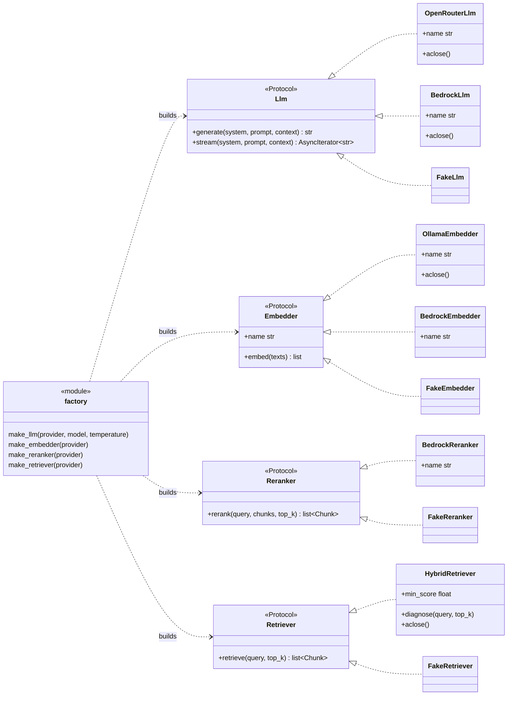
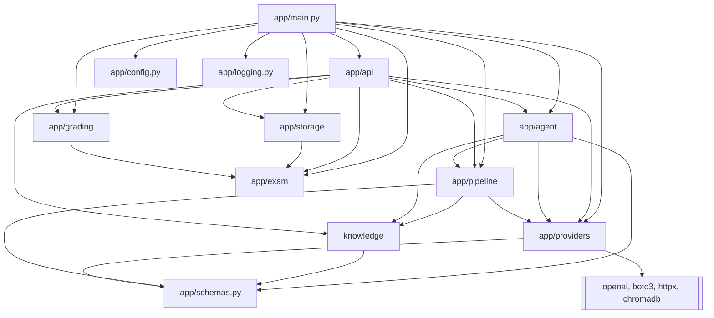
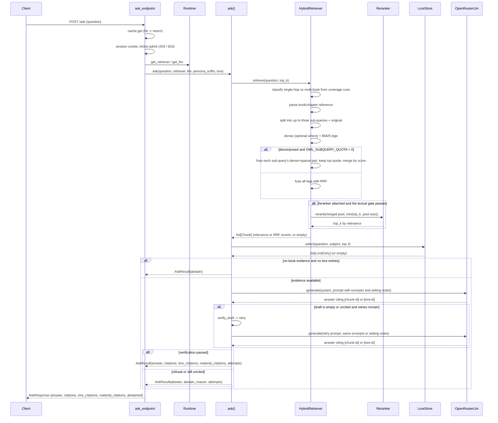
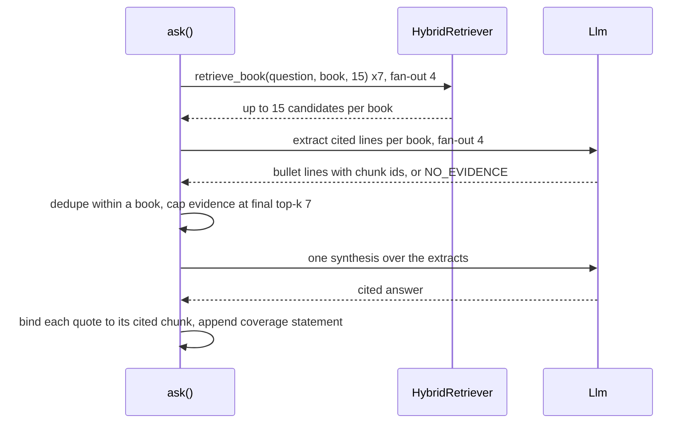
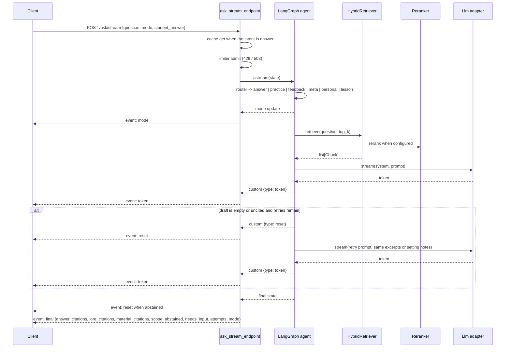
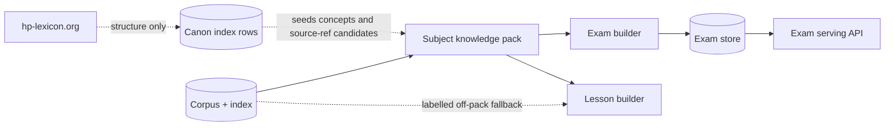
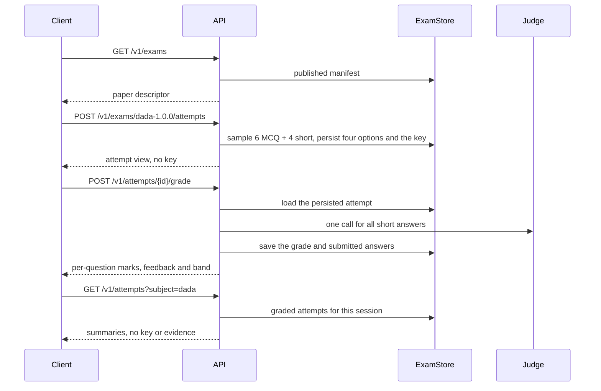

# Architecture

One page, three views of the engine: the layers, the provider contracts, and the
request flows. It describes the built chat surface and the exam-bank boundary
as it lands. The README diagram is the full V1-V3 vision.

Keep this in sync when the contracts or the top-level flow change. The diagrams
are Mermaid code, so they render on GitHub and diff in review like any other file.

## Layers

| Layer | Path | Responsibility |
|---|---|---|
| HTTP | `app/api/`, `app/main.py` | routes, CORS, request/response schemas, composition root |
| Agent | `app/agent/` | LangGraph state, chat-intent router, answer / practice / feedback / meta / personal / lesson nodes |
| Knowledge | `app/knowledge/` | lore pack schema, loader and setting-note selection; subject taxonomy, material records, source refs, pack storage, validation and published-pack summaries (#87); the derived in-memory material selector for lesson mode (#166), the plural-aware term helper and the curated concept-title/alias matcher; the DADA and Charms packs are published; pack wiring and the remaining subjects remain on #128 |
| Exam bank | `app/exam/`, `app/storage/` | bank records, pack/corpus validator, SQLite import and the served attempt (#193); the DADA (#190) and Charms (#213) banks 1.0.0 are published |
| Pipeline | `app/pipeline/` | ingest, index, retrieve (hybrid + rerank), generate |
| Providers | `app/providers/` | model adapters behind contracts (openai, boto3); the vector store SDK lives in the index builder |
| Config | `app/config.py` | environment settings (`OWL_` prefix) |
| Logging | `app/logging.py` | one formatter, level from settings, a per-request id |
| Domain | `app/schemas.py` | `Chunk` and its metadata |

Pipeline stages, in order:

| Stage | Module | Entry point |
|---|---|---|
| Ingest | `app/pipeline/ingest/` | `ingest_corpus`, `make_chunks`, `parse_chapters` |
| Index | `app/pipeline/index/` | `build_index`, `build_lexical_index` (uses `Chunk.context` when present) |
| Retrieve | `app/pipeline/retrieve/` | `compose_retriever`, `HybridRetriever.retrieve` (filter + decompose + hybrid + rerank), `diagnose` |
| Generate | `app/pipeline/generate/` | `ask`, `ask_lesson` (pack-first scope with a labelled corpus fallback), `build_prompt`, `ground_answer`, `ground_lesson_answer`, `verify_draft` |
| Agent | `app/agent/` | `build_graph`, `route`, `answer_node`, `practice_node`, `feedback_node`, `meta_node`, `personal_node`, `lesson_node` |

`parse_chapters` drops the front matter before book 1 and trims the previous
book's trailing copyright page plus the next book's dedication and contents from
the previous book's last chapter (#113). The trim uses the copyright page as the
boundary, requires a contents page at a book boundary, and scans a short window
back, so chapter detection and chunk size are unchanged.

Exam-bank and canon-index stages (canon-index rows are built; the rest is planned):

| Stage | Module | Responsibility |
|---|---|---|
| Canon index harvest (built, #125+#126) | `app/pipeline/ingest/lexicon/` | sitemap discovery, polite cached fetch of hp-lexicon.org, entry and chapter parse plus fetch metadata to gitignored JSONL |
| Canon index resolve (built, #127) | `app/knowledge/lexicon.py` | agreement join (forward citations vs chapter tabs vs sidebar), chunk-candidate resolution with phrase priority and spans, deterministic review sample and integrity verification |
| Subject packs | `app/knowledge/` | subject taxonomy, material records, source refs, pack build and validation |
| Exam bank | `app/exam/` | bank records, pack and corpus validation, duplicate and publication gates |
| Exam build | `app/pipeline/exam/` | offline plan, retrieve, generate, validate, persist |
| Exam store | `app/storage/` | SQLite banks, items, attempts and grades imported or persisted by `app/storage/exam_store.py` (#189/#193) |
| Grading | `app/grading/` | built (#192): deterministic MCQ scoring, one-call short-answer LLM judge, deterministic totals and bands |

## Build vs managed

| Decision | Choice | Why |
|---|---|---|
| Vector store | Chroma | Local, inspectable, no managed dependency |
| Sparse retrieval | `rank_bm25` | Shows hybrid fusion and tokenization trade-offs |
| Rerank | Bedrock adapter | Vendor boundary with a measured floor and pool |
| Orchestration | LangGraph | Explicit state and edges, traceable per node |
| Evaluation | Own harness | The differentiator; managed tools hide the gold set and gate |
| Serving | FastAPI plus SSE | Full control of streaming, limits and the cache |
| Logs and traces | JSONL, optional S3 | Own the schema; no SaaS lock-in |

The point is to own the pipeline logic, not the primitives. Reimplementing a
vector index or an LLM would add bugs without demonstrating retrieval design.

## Contracts and adapters

The four Protocols in `app/providers/contracts.py` are the architecture. Adapters
satisfy them structurally (duck typing), so the arrows below are "implements",
not class inheritance. The factory is the only place a provider name becomes an
object, and it is called once at startup.



Bedrock hosts the reranker (`amazon.rerank-v1:0`), the cloud embedder
(`amazon.titan-embed-text-v2:0`) and the V2 Llm (`BedrockLlm` over the Converse
API, default `qwen.qwen3-32b-v1:0`). OpenRouter remains the pinned eval and V1
path; `OWL_PROVIDER` selects the Llm at composition time. Ollama serves
embeddings for local dev. When a reranker is attached, `HybridRetriever`
retrieves a wide pool and reranks it down to `top_k`, and the abstention floor
becomes the rerank relevance floor. With `OWL_SUBQUERY_QUOTA > 0`, a decomposed
question fuses each retrieval leg separately and keeps only its top quota before
merging by score; the default 0 fuses all legs globally. The reranker request is
capped at the pool size because Bedrock rejects `numberOfResults` above the
source count.

`app/pipeline/retrieve/strategy.py` labels each question `single_hop` or
`multi_book` from deterministic coverage cues and explicit book numbers. The
label, reason and cues are emitted in the trace and carried on
`RetrievalTrace`. `app/pipeline/retrieve/multibook.py` implements the retrieval
half of that path: one filtered pass per book, capped at seven calls with a
fan-out of four, then merge, dedupe and score order. The path is measured with
`scripts/measure_aggregation.py --strategy routed`. With
`OWL_MULTI_BOOK=true`, `ask()` delegates a `multi_book` question to
`app/pipeline/generate/multibook.py`: per-book retrieval, one extraction per
book, merge, one synthesis and a deterministic coverage statement. The flag is
off by default, so the default chat path is unchanged. The `top1_floor` and
`batched_top3` extraction strategies exist for the #105 ablation;
`per_book` is the shipped default. The flag stays off after the negative
holdout.

## Module dependencies

Dependencies point inward. Vendor SDKs (`openai`, `boto3`, `httpx`, `chromadb`) are
imported only inside `app/providers` and the index builder, never by the API or the agent.



## API surface

The served contract is documented in `docs/api.md`: the current `/` JSON
descriptor, `/health`, `/ask`, `/ask/stream`, `/v1/subjects` and exam serving
routes, the SSE event schema, the error shapes, and the remaining planned `/v1`
surface for chat and persona. The split is by purpose, not by subject: a subject is request data,
chat intents stay internal, and the exam bank and grading are separate
resources. The versioned aliases still gate per-subject chat; the frontend
already ships as its own static build.

## Frontend surface

`web/` is a React + Vite single-page app, built to static assets and served on
Cloudflare Pages, separate from the API container (docs/deploy.md). Only the
venue chat calls `POST /ask/stream`; the gate and the cloister are static over
the session-scoped result store. The build imports no Python, renders no model
output as HTML, and runs no request-time generation.
Two interfaces keep the boundary between the UI and the services:

| Interface | Lives in | Today | Swap when |
|---|---|---|---|
| `ExamClient` | `web/src/api/exams.ts` | `HttpExamClient` lists papers, starts an attempt and submits it for server grading; the API can return the same persisted attempt by id, and the browser never sees the MCQ key before the grade response | accounts move records across devices with #35 |
| `ResultsStore` | `web/src/api/results.ts` | `HttpResultsStore` reads `GET /v1/attempts` for the signed session; records are provisional | #35 moves history to a user id |

The static subject list decides which departments are open. The venue fetches
`GET /v1/subjects` for the published pack and the live `persona`, `persona_subject`
and `lesson` flags, so the DADA room sends `mode=lesson` only when the API says
the selector is loaded. `persona_subject` names the home subject of the live
card, so only that room takes the live voice copy; every other open room keeps
the rehearsal copy even when the site-wide persona flag is on. A statically open
department with no pack stays on the corpus path with a note; a statically
"soon" department stays furnished until its product entry is opened. The static
persona state is only the fallback when the API is unreachable. The `build`
check of the `web` workflow runs the Pages build on
every pull request and push to main, and deploy-preview origins are covered by
the API's CORS origin regex. `web/README.md` carries the component map and the
honesty rules.

## Request flow: POST /ask



One deadline covers the whole request: `OWL_ASK_TIMEOUT_S` (default 30 s) wraps
retrieve plus generate. On expiry `/ask` returns 504 with `{error, request_id}`
and logs the stage that was running; `/ask/stream` is not bounded, because a
legitimate stream can outlive it. The deadline frees the response, not the
worker: a provider call already running in a thread is not cancellable, so a
timed-out request can keep its thread busy until the client's own timeout.

`verify_draft` is deterministic: an empty draft or one that cites no retrieved
chunk and no lore entry fails. A grounded draft passes; a deliberate refusal is final and is never
retried, so abstention keeps its meaning. A paraphrase refusal is final when it
cites nothing, trails into a further refusal, or has nothing but the refusal
clause; a cited partial answer that moves on to a new or contrastive clause is
kept. The retry budget is `OWL_RETRY_BUDGET` (default 1, so at most two drafts).

## Multi-book answer path

This path is flag-gated and runs only when the router says `multi_book`.



Caps: seven retrieval calls, seven extraction calls, fan-out four, up to 15
candidates per book, one synthesis, final top-k 7. An explicit book-number
question searches only the named books, and the coverage statement covers that
subset. If no book yields a cited extract, the path abstains.

Extraction keeps a line only when its quote is verbatim in a chunk from that
book. Dedupe is per book: a repeated sentence is dropped inside one book but
kept across books, because the coverage claim is per book. Conflicting lines are
not resolved by the merger; both reach synthesis labelled by book.

After synthesis, a line is kept only when every non-empty segment of its quote
appears in the chunks it cites and its `Book N` label matches those chunks.
Unknown citations are stripped by `ground_answer`. The coverage statement is
computed from the lines that survive binding, so a book whose only line was
dropped is reported as having no evidence rather than being claimed as covered. This path does not use the single-pass retry: a
synthesis with no supported citation abstains instead of retrying. A provider or
per-book retrieval failure is not converted to no evidence; it propagates and
`/ask` returns 502.

## Request flow: POST /ask/stream



SSE events:

| Event | Payload | When |
|---|---|---|
| `mode` | `{"mode": "answer"}` | after the router update |
| `token` | `{"text": "..."}` | for each streamed token |
| `reset` | `{"reason": "retry"}` before a retry draft, `{"reason": "fallback"}` before a routing fallback; `{}` before `error` and before `final` when `abstained` | clears the draft; a no-op when nothing was streamed |
| `final` | `answer`, `citations`, `lore_citations`, `material_citations`, `scope`, `abstained`, `needs_input`, `attempts`, `mode` | once, authoritative |
| `error` | `{"detail": "..."}` | provider or internal failure after headers, always preceded by `reset` |

`/ask/stream` uses the compiled graph from `app/agent/`. The router is
deterministic. An explicit `answer`, `practice` or `feedback` wins. A supplied
student answer is a feedback request, a practice request is a question or short
set of questions, and everything else is answer. When `OWL_PERSONA` is on, narrow
meta and personal cues route to scripted replies before the answer path.
`mode=lesson` is a preference, not an override: it applies only when the
classification would otherwise be `answer`; practice, feedback, meta and
personal keep their routes, so a lesson-default venue still greets and tests.
Name variants and fuzzy spellings of the professor are normalised before the
persona cues; book professors such as Snape stay on the answer path.
Meta and personal skip retrieval and the model, so they stream no tokens. Tokens
are a draft. Citation validation runs on the complete answer, so an ungrounded
stream emits `reset` before the authoritative `final` event. A failed
deterministic verification emits `reset` and streams one retry when the budget
allows; the client drops the rejected draft on the same event. Provider failures
arrive as an `error` event because HTTP headers are already sent.

### Lesson branch

When the classification would otherwise be `answer` and the request mode is
`lesson` with `OWL_LESSON_MODE` on, the graph routes to `lesson_node` instead of
`answer`. The derived selector scores the in-memory material vectors and the
prompt carries the selected materials. A deterministic coverage check compares
the question's content terms with the material prose and the concept
titles/aliases. If the pack covers the question, the draft must cite `[mat:<id>]`
and the branch makes no retrieval call. If the pack is empty or leaves terms
uncovered, the branch retrieves the corpus as a labelled second tier
(`OWL_LESSON_FALLBACK`, default true), builds
"Lesson notes (this department)" and "Set-text excerpts (outside this
department)" sections, and requires the matching citation space. `scope` is
`in_pack`, `mixed`, `off_pack` or `abstained`; an off-pack answer starts with
"This is not in the department's notes" and a mixed answer cites both spaces.
The final payload carries `material_citations`, book `citations` and `scope`.
With the fallback off, a question with no material above the floor abstains
with `no_evidence`; a selected material that leaves terms uncovered stays
pack-only. With the fallback on, an uncovered term with no corpus evidence also
abstains rather than returning a partial `in_pack` answer. The fallback is
lesson-only: exam generation and authoritative grading must use pack
materials and their source refs, never the corpus fallback.

## Model routing

Routing is a deterministic intent split, off by default. With
`OWL_ROUTING=intent`, practice and feedback use `OWL_SMALL_MODEL` (default
Mistral Small 3.2 via OpenRouter); answers stay on the main model. A provider
error on the small model falls back to the main model once, emitting a `reset`
first because the draft may already be on the client. The route and any
fallback are trace spans, and the model is on the usage line. No model call is
used to decide the route.

The routing experiment was measured and rejected: Mistral Small 3.2 was cheaper
and faster, but citations dropped from 15/20 to 13/20 and specific error naming
from 5/5 to 2/6. `OWL_ROUTING` stays off. See
`docs/runs/2026-11-06-v2-routing-comparison.md`.

A vendor policy check runs before an adapter is built. OpenAI, Anthropic and
Google models are rejected, including their open-weight releases, because the
deployment region bans them regardless of host.

## Tracing

Each request can emit flat JSONL span records under the request id. The stream
path emits `router`
(intent), `retrieve` (chunk ids and top score), one `generate` per attempt
(model, prompt hash and length), `verify` (ok and reason), `retry`, and `final`.
Cache hits emit a `cache` span instead of retrieve/generate.

Traces go to the `owl.trace` logger and, when `OWL_TRACE_FILE` is set, to a
size-capped file that is safe to ship. Prompt text is never emitted: the span
carries a hash and a character count so a run can be identified without storing
the excerpts. The trace records the agent's decisions, not hidden model
reasoning.

Retrieved text is treated as untrusted. `sanitize_evidence` removes instruction
spans from the evidence and logs the affected chunk ids; a chunk left empty is
dropped from the citation set ("ignore previous instructions", "reveal the prompt", "you must
now"), and the answer system prompt tells the model to ignore instructions inside
excerpts.

## Chat intents vs exam bank

The chat graph is the online surface. Its three core intents are intentionally
lightweight. Two persona intents are added when `OWL_PERSONA` is on:

| Intent | Trigger | Output | Persisted | Authoritative |
|---|---|---|---|---|
| `answer` | a question about the books | grounded explanation with citations | no | no |
| `practice` | "give me a practice question on ..." | one or two grounded questions, streamed | no | no |
| `feedback` | "mark my answer", or a supplied answer | formative feedback and a provisional mark | no | no |
| `meta` | persona on; identity, subject scope, subject definition, exam (non-disclosure), syllabus, grading, school, professor, Auror pathway, boundaries, greeting | reviewed text from the persona card, no model call | no | no |
| `personal` | persona on; a personal message | reviewed acknowledgement and redirect, no model call | no | no |
| `lesson` | classification would be answer, explicit `mode=lesson`, `OWL_LESSON_MODE` on | persona-first teaching prose from selected pack materials, `[mat:<id>]` citations plus resolved book refs; labelled corpus fallback when the pack is thin (`scope`) | no | no |

Lesson mode is the one intent grounded in a subject pack first; the corpus is a
labelled fallback when the pack is thin. The selector is derived at startup by
embedding material texts in memory and scoring a question by cosine; the corpus join through `source_refs` remains the
grounding check, not the selector. A pack-backed lesson answer cites material ids
in `material_citations` and their book chunks in `citations`; an off-pack answer
has empty `material_citations` and cites the retrieved book chunks directly.
With the flag off the request is rejected and the measured corpus path is
unchanged.

The #216 target is answer contract and knowledge authority, not whether a
phrasing is already in the cue list: policy, closed facts and teaching are
separate contracts, and a router miss is unclassified rather than a lesson
question. The plan of record, gates, citation types and measurement bar are in
`docs/routing-contracts.md` (#216). #219 changes the router so the lesson path is
opt-in and unclassified traffic clarifies or abstains; today the router still
promotes a miss to lesson.

With the persona on, the lesson system prompt is persona-first: identity,
register and stance precede the grounding rules, a short voice reminder closes
them, and the teaching shape is a direct answer, why it matters, an example from
the notes, a caution and a short check. The note prose is rendered without its
inline book chunk ids, so the only note citation the model sees is the material
id; the material source refs still resolve on the response. The conformance
fixture in `eval/persona/` runs deterministic citation, source-hash, boundary,
style and length checks before a pinned judge scores voice and teaching shape
only. The 2026-11-09 record is `docs/runs/2026-11-09-176-persona-lesson-voice.md`.

## Persona layer

`OWL_PERSONA` (default false) adds the reviewed professor card in
`config/persona.toml` to the answer prompt and enables the two scripted intents.
The card is the source of truth; `docs/persona.md` is the human copy.

The answer path appends `Persona.answer_suffix()` after the grounding rules, so
citations and abstention still apply. The persona never adds facts to a grounded
answer; scripted meta replies state reviewed setting facts from the card. Scripted
meta and personal replies are not generated, so the professor cannot invent a
date, a rule or a fact while introducing himself. When a grounded answer
abstains, the persona-on path replaces only the user-facing line with the card's
in-world refusal; the `abstained` flag and empty citations are unchanged. The
card also carries a public-history boundary: the professor knows the war and
post-war outline as public history, but a detail still cites the book chunks and
he does not claim private knowledge of the people named in the book chunks.

The persona is DADA-only. The lore pack already carries the five founders and
departments, but the chatbot speaks only for Defense; other subject personas are
deferred. `persona_subject` (default `dada`, `OWL_PERSONA_SUBJECT`) carries that
home subject to the frontend, so opening another department does not claim a
live professor there. The flag itself stays site-wide until the registry lands. The card and the doc change together; `tests/test_persona.py` asserts
every meta topic exists. The scripted meta, personal and abstention replies carry
a reviewed variant bank; one phrasing is chosen at random per request, and the
facts, boundaries and `abstained` flag are identical across variants.

The suffix applies to the single-pass answer path. `OWL_MULTI_BOOK` and
`OWL_PERSONA` together are unsupported until the multi-book path lands; the
multi-book branch ignores the suffix, and `create_app` logs a warning when both
flags are on. The persona's exam boundary is qualified to the school
examination, so a question about a book exam, such as an O.W.L., is still
answerable from the excerpts.

The non-stream `/ask` endpoint is the grounded answer API. Meta and personal are
chat intents on `/ask/stream`; `/ask` does not route them.

`app/knowledge/lore.py` holds authored setting facts with a canonicity tier
(`book`, `product`, `secondary`). It is raw Markdown with TOML front matter, one
entry per file, selected by subject and keyword, not embedded, so a setting edit
is a text edit plus a reload. A single JSONL file is also accepted. The thin
slice uses `eval/fixtures/lore/` (one Markdown entry per file, TOML front matter); the real pack stays out of git.
Lore-grounded answers and `[lore:<id>]` citations are wired (#118): the answer
path selects up to three setting notes, validates the two citation spaces
separately, and abstains only when neither has a citation. The real pack is
published at 1.0.0; the lore eval follows (#97) and the lesson voice is
delivered (#176).

The exam bank is a separate, offline surface. It is not a chat intent and it does
not run inside `/ask` or `/ask/stream`. Exam generation reads from versioned
subject knowledge packs; lesson mode reads from packs first and may use the
labelled corpus fallback:



The DADA and Charms banks 1.0.0 are published under `data/exams/dada` and
`data/exams/charms`, each with 25 MCQ and 25 short-answer items.
`docs/exams/dada-1.0.0.md` and `docs/exams/charms-1.0.0.md` are the structure-only
records; the matching `.manifest.toml` snapshots hold the versions and pins. The
serving API is built (#193): it samples a paper per attempt from the imported
bank and serves it without a model call, and `GET /v1/exams?subject=charms`
selects the second bank.

A pack contains subjects, topics, concepts, materials and source refs. Every
material points to a chunk id, book, chapter, quote, text hash and index hash.
Every generated exam question and every pack-backed lesson section must cite a
material id and source ref; the validator rejects anything else before
publication. A labelled off-pack lesson section cites set-text chunk ids instead;
exam generation and authoritative grading never consume that fallback. Secondary
references such as a Lexicon entry may be stored as links for discovery and
attribution, but they are not the canonical source and are never copied into
the pack. The item/concept-to-chapter index that seeds those links is built
from structure only (citation codes and links, never site prose); its plan of
record is `docs/lexicon-canon-index.md`.

Canon tiers are explicit:

| Tier | Sources | Exam use |
|---|---|---|
| Primary | the seven novels | exam-gradable, the only source refs |
| Secondary | Rowling companion books | optional further reading, not exam-gradable in v1 |
| Tertiary | interviews, Pottermore, Cursed Child | optional metadata, not exam-gradable |
| Excluded | films, games, fan works | discovery only |

A subject with thin primary coverage is reported as thin. It is not padded with
film or secondary material.

| Stage | Where it runs | Output |
|---|---|---|
| Pack build | batch job over the corpus | validated materials with source refs and pack version |
| Exam build | batch job over the packs | validated questions, rubrics, evidence snapshots |
| Exam store | SQLite in `/data` | banks, items, persisted attempts and grades |
| Exam serving | `GET /v1/exams` and `POST /v1/exams/{paper_id}/attempts` | sampled stored paper and attempt view, no model call |
| Attempt grading | `POST /v1/attempts/{attempt_id}/grade` | deterministic MCQ plus one pinned judge call, then a deterministic band |

The bank is authored as `data/exams/<subject>/bank.jsonl` plus `manifest.toml`,
validated by `app/exam/bank.py`, and imported into `data/exams/exams.db` by
`scripts/import_exam_bank.py`. An item stores its material id, source refs and
evidence snapshot; the validator recomputes every hash against the corpus. MCQ
items keep at least six options, while the serving view samples four per
attempt. Short-answer items keep a golden answer and rubric for the judge.



The attempt is persisted before the client sees it, so a reload returns the same
options and a repeated grade returns the stored result without a second judge
call. The server never puts `correct_option_id`, the golden answer, the rubric
or evidence into the pre-submission view. The history list is scoped to the
signed anonymous session cookie, and another session gets `404` on the attempt
and grade routes, so an attempt id is not a shared bearer token. The exam limiter
caps attempts at three per day anonymous, five signed-in and nine per day per
IP; it is separate from the chat limiter.

The boundary matters because the two surfaces have different guarantees. Chat
practice is disposable and formative. Exam-bank papers are validated, versioned
and reproducible.

### Hybrid grading

An O.W.L. paper mixes question types, so grading is not one algorithm:

| Question type | Scorer |
|---|---|
| `mcq` | deterministic match by option id |
| `short_answer` | pinned LLM judge against the stored golden answer and rubric |
| `long_answer` | pinned LLM judge with the stored rubric and evidence |

Each question stores its maximum marks, rubric criteria, evidence snapshot and
model answer. One judge call covers all free-text answers in an attempt and
returns per-question structured JSON:

```json
{
  "results": {
    "dada-short-01": {
      "criteria": [
        {"criterion_id": "correctness", "awarded": 2, "max_marks": 2, "reason": "..."},
        {"criterion_id": "completeness", "awarded": 1, "max_marks": 2, "reason": "..."}
      ],
      "total": 3,
      "feedback": "...",
      "evidence_ids": ["b3-c10-0036"]
    }
  }
}
```

The scorer validates that every criterion appears once, that `0 <= awarded <=
max`, that the total is the sum, and that evidence ids are a subset of the
question evidence. A parse or validation failure gets one retry for the
attempt, then a `needs_review` state for the affected questions; it is never
silently scored zero.

Totals and bands are computed by code. The LLM writes criterion marks and
feedback; it does not write the final grade. The judge is pinned by model,
temperature 0, prompt version and rubric version. It must be a different model
family from the question generator. Grading outputs are cached by exam version,
question id, answer hash, rubric content and judge configuration so a regrade is
reproducible.

The implementation lives in `app/grading/`: `score_mcq`, `grade_attempt`,
`JudgeCache` and `band_for`. The public records are `AttemptAnswer`,
`AttemptGrade` and `QuestionGrade`; `tests/test_exam_grading.py` covers the
validation and retry paths. The package imports `app.exam.bank` and the provider
contracts; it never imports the chat agent.

An owner-reviewed calibration set (the marks are AI-proposed from the rubric
and adopted by the owner) measures exact and adjacent agreement, mean absolute
error and per-criterion agreement. That set is the evidence that the judge is
usable, not a claim that it is infallible.

The DADA bank eval and calibration are in `eval/exam/` (#191): deterministic
bank checks, independent model checks and a 24-case calibration set over 8 short
answers. The record is `docs/runs/2026-11-09-191-dada-bank-eval.md`.

If a future feature wants to save a chat-generated question to the bank, it must
go through validation and versioning, not write directly.

### Memory and identity

The chat is stateless today. Short-term memory is a later phase: a `thread_id`, a
graph checkpointer, recent messages plus a rolling summary, and a rewrite node
that resolves follow-ups. Anonymous threads are enough for a continuous
professor chat.

Per-user long-term memory is the last optional phase. It needs Google OIDC, a
users table, per-user ownership on top of the session ownership that already
exists, and storage for chat threads and exam attempts. It also needs retention,
export and delete rules. Auth is deliberately not a dependency of the exam bank
or of short-term chat continuity.

See `docs/workplan.md` for phase order and exit criteria.

### Cost controls

Chat is the variable-cost surface; exam content is mostly offline. The chat
controls (#88) enforce per-session limits (10/min, 100/day, 2 concurrent), the same minute and
concurrency limits per IP plus a 100/day IP cap, and a daily token budget. Over a limit the API returns 429
with `Retry-After`; over the budget it returns 503 for chat only, so `/health`
and the exam routes stay up. Exam attempts use a separate per-session daily cap
(3 anonymous, 5 signed-in), so a chat limit never consumes an exam attempt.
Counters live in the one API process, so a restart resets the windows; auth
later moves them to a user id.

Corpus-only answers pass through an in-process exact cache keyed by prompt
version, index text hash, retrieval settings, embedder and reranker config,
model, normalised question, the persona flag, a hash of the persona suffix, the
lore pack version, the lore selection version, and (when lesson mode is on) the
pack fingerprints, lesson top-k, floor, fallback setting and subject. Practice,
feedback, meta, personal and lesson never read or write it: feedback is personalised by the
student answer, practice is meant to vary, meta/personal are scripted, and
lesson answers are pack-first and scope-tagged. Usage is logged for
each processed request, cache hits included; a 429, 502, 503 or 504 does not
produce a line. The line carries estimated input/output tokens,
model, intent, cache hit, cost and latency; a client that disconnects before the
stream ends may not produce a line. Prices are configuration, not constants.

The `Runtime` (the retriever with its optional reranker, the llm, the compiled
agent graph, the index text hash used by the cache key, and the loaded pack store
with its derived lesson selector) is built once in the app lifespan, never per
request.
Provider failures surface as a normalized `ProviderError` and become a 502 at
the edge, or an SSE `error` event once a stream has started.

Logging is one formatter at `OWL_LOG_LEVEL`. Each request gets a short id
(echoed as `X-Request-ID`), and `ask()` logs per-stage timings (retrieve,
generate) so a slow request can be attributed to a stage without a profiler.
The retriever and the providers add DEBUG lines (dense, sparse, rerank, embed,
generate) for the per-call detail.

## Data shapes

| Type | Module | Kind | Purpose |
|---|---|---|---|
| `Chunk` | `app/schemas.py` | pydantic | retrieved passage, metadata, optional generated context for indexing, relevance or fused score |
| `ChunkMetadata` | `app/schemas.py` | pydantic | book and chapter identity |
| `AskResult` | `app/pipeline/generate/generate.py` | dataclass | answer, citations, lore_citations, material_citations, scope, lore_chars, abstained, chunks, attempts, model_calls, retry_reason, abstain_reason, prompt_chars |
| `AgentState` | `app/agent/state.py` | TypedDict | question, chat mode, meta topic, student answer, chunks, answer, citations, lore_citations, material_citations, scope, abstained, needs_input, attempts, model_calls, abstain_reason, retry_reason, llm_model, prompt_chars |
| `RetrievalSetup` | `app/pipeline/retrieve/composition.py` | dataclass | wired retriever plus build facts |
| `BuiltIndex` | `app/pipeline/index/builder.py` | dataclass | collection, rebuilt flag, dims |
| `IngestSummary` | `app/pipeline/ingest/ingest_corpus.py` | dataclass | ingestion counts and sizes |
| `Persona` | `app/agent/persona.py` | dataclass | reviewed identity, register, boundaries, variant banks for meta, personal and abstain replies, in-world abstention |
| `LoreEntry` / `LoreStore` | `app/knowledge/lore.py` | dataclass | authored setting fact with a canonicity tier; loaded pack with keyword selection |
| `AttemptAnswer` / `AttemptGrade` / `QuestionGrade` / `CriterionGrade` | `app/grading/models.py` | pydantic | answer shape, per-question criteria and marks, per-attempt total and band |
| `JudgeConfig` | `app/grading/models.py` | dataclass | pinned judge model, temperature, prompt version, provider and max tokens |
| `Runtime` | `app/api/runtime.py` | dataclass | retriever, llm, small_llm, compiled agent graph, index hash, published pack summaries, pack store, derived lesson selector, exam store, exam judge and judge cache |
| `AskRequest` / `AskResponse` | `app/api/schemas.py` | pydantic | HTTP contract |
| `StreamRequest` | `app/api/schemas.py` | pydantic | question, chat-intent override, optional answer to review |

Subject-knowledge types (schema landed on #87; the DADA and Charms packs are
published; the extraction build and pack wiring remain on #128):
| Type | Module | Purpose |
|---|---|---|
| `Subject` | `app/knowledge/taxonomy.py` | one of the 12 O.W.L. subjects |
| `Topic` | `app/knowledge/packs.py` | subject topic and parent topic |
| `Concept` | `app/knowledge/packs.py` | spell, character, event, definition or procedure, with aliases |
| `Material` | `app/knowledge/materials.py` | grounded explanation or passage with kind, canon tier, canon scope, review status and canonical text |
| `SourceRef` | `app/knowledge/materials.py` | chunk id, book, chapter, quote, text hash, index hash, citation bucket (books only) |
| `ReferenceLink` | `app/knowledge/materials.py` | optional secondary source with title, URL, publisher and access date |
| `SubjectPack` | `app/knowledge/packs.py` | manifest, records, load and write |
| `PackSummary` | `app/knowledge/packs.py` | served summary of one published pack: subject, version, fingerprint, topic ids, counts |
| `load_pack_summaries` | `app/knowledge/packs.py` | published, valid packs under `OWL_SUBJECTS_PATH`; drafts and broken packs are skipped |
| `PackValidation` / `Coverage` | `app/knowledge/packs.py` | deterministic corpus join and thin-subject report |

Canon-index types (spike shapes and resolver landed on #125/#127):

| Type | Module | Purpose |
|---|---|---|
| `ResolvedCitation` | `app/pipeline/ingest/lexicon/codes.py` | citation code with bucket, book, chapter, medium and epilogue flag |
| `Citation` / `EntryPage` / `ChapterPage` | `app/pipeline/ingest/lexicon/parse.py` | page structure: code plus origin plus parse-time bucket, entry identity, chapter reverse tabs |
| `QueueItem` / `FetchResult` | `app/pipeline/ingest/lexicon/{discovery,fetch}.py` | work queue row; fetch record with access date and response hash |
| `CanonEdge` / `Candidate` | `app/knowledge/lexicon.py` | built (#127): entry, book/chapter/epilogue key, agreement, sources, candidate refs as (chunk id, text hash, span) |

Built bank types (#189):

| Type | Module | Purpose |
|---|---|---|
| `BankManifest` | `app/exam/bank.py` | version, resource pins, generator and judge config, counts |
| `BankItem` | `app/exam/bank.py` | MCQ or short-answer item with material and evidence grounding |
| `McqOption` | `app/exam/bank.py` | one stored option in the six-or-more pool |
| `RubricCriterion` | `app/exam/bank.py` | criterion id, description and maximum marks |
| `ShortAnswerKey` | `app/exam/bank.py` | golden answer, required points and rubric |
| `EvidenceSnapshot` | `app/exam/bank.py` | chunk id plus excerpt text, book and chapter at generation time |
| `AttemptQuestion` / `ServedOption` | `app/exam/attempts.py` | one persisted question; the MCQ options served plus the server-side correct option id |
| `AttemptRecord` | `app/exam/attempts.py` | sampled attempt: paper id, bank version, session id, questions, later grade |
| `AttemptSummary` | `app/exam/attempts.py` | one graded attempt in the session history list; no question detail |
| `AttemptView` / `QuestionView` | `app/exam/attempts.py` | the pre-submission client payload; no key, golden answer, rubric or evidence |
| `ExamStore` | `app/storage/exam_store.py` | SQLite banks, items, session-owned attempts, grades and submitted answers |

Planned storage types, once the remaining #38 surface lands:

| Type | Module | Purpose |
|---|---|---|
| `ExamFormat` | `app/storage/models.py` | subject blueprint, canon basis, fidelity, marks, duration and question mix |
| `Exam` | `app/storage/models.py` | paper identity, scope, version, publication status |
| `Question` | `app/storage/models.py` | prompt, type, max marks, stored rubric, evidence snapshot |
| `Attempt` | `app/storage/models.py` | one student submission, total score, band, judge config |
| `Response` | `app/storage/models.py` | one answer, awarded marks, feedback, matched criteria |
| `JudgeRun` | `app/storage/models.py` | judge model, prompt version, rubric version, raw or hashed output |

## Keeping this current

- Update the contracts diagram when a Protocol or an adapter changes.
- Update the sequence diagrams when the `/ask` or `/ask/stream` flow changes.
- Update the SSE event contract in this page when `app/main.py` changes an event
  name or payload field.
- Update the Frontend surface section when `web/` gains a server component,
  changes an interface boundary (`ExamClient`, `ResultsStore`) or the voice
  rule.
- `pyreverse -o puml -d /tmp app` (pylint) can bootstrap the class view from source;
  the hand-kept diagrams stay small on purpose, so they describe seams rather than
  every method.
