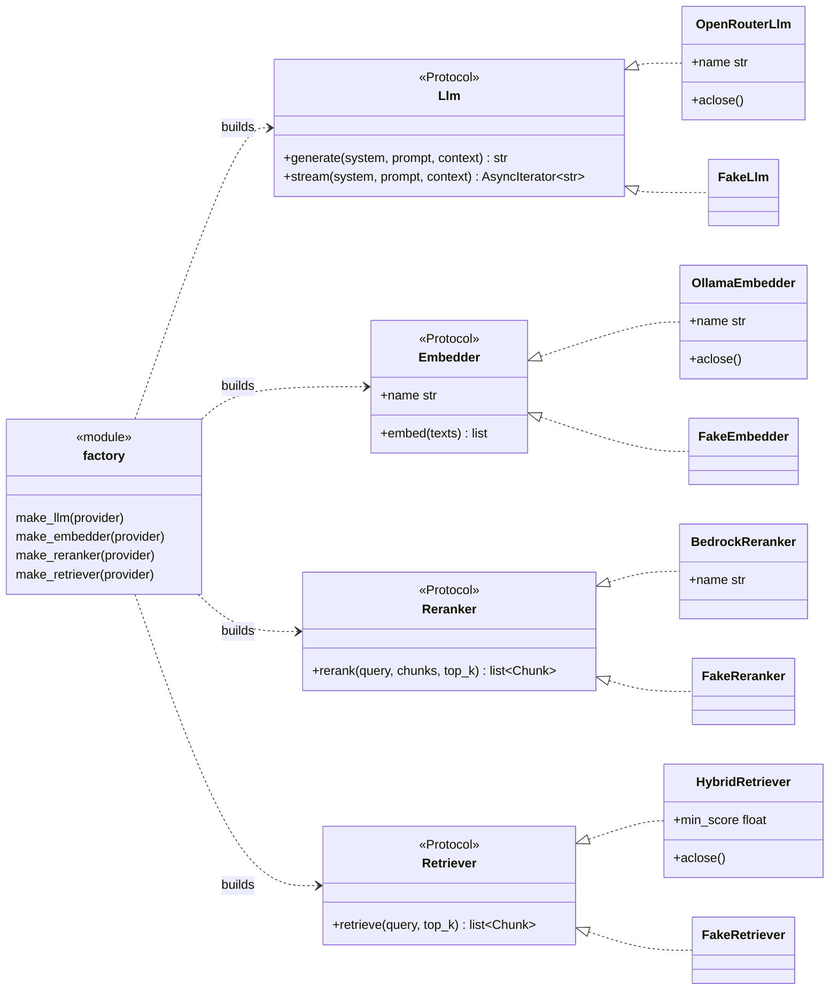
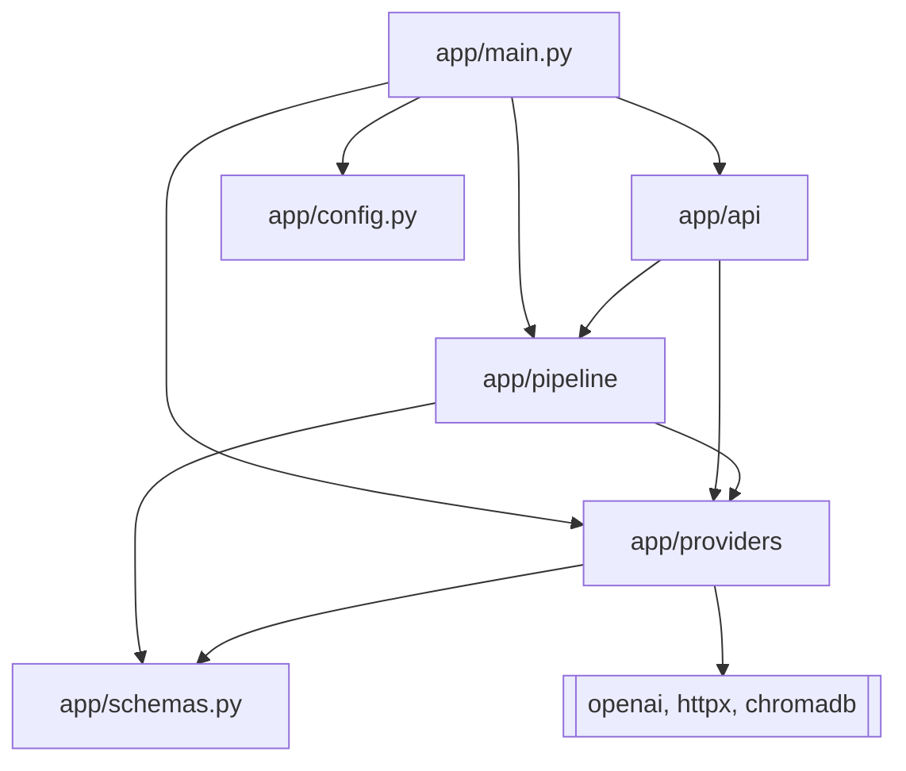
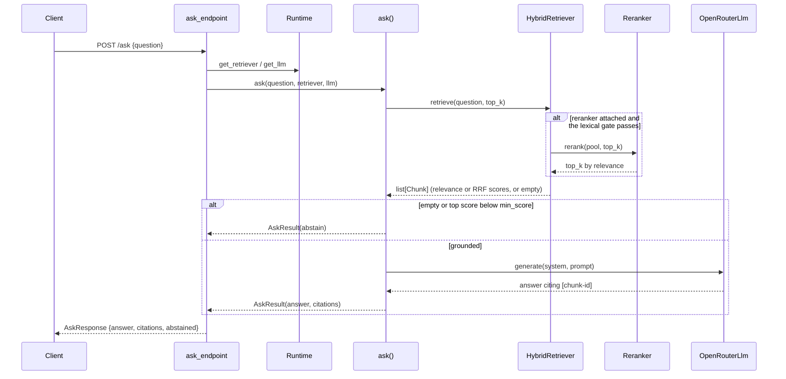

# Architecture

One page, three views of the V1 engine: the layers, the provider contracts, and
the `/ask` request flow. It describes what is built today; the README diagram is
the full V1-V3 vision, including the LangGraph loop and streaming that land later.

Keep this in sync when the contracts or the top-level flow change. The diagrams
are Mermaid code, so they render on GitHub and diff in review like any other file.

## Layers

| Layer | Path | Responsibility |
|---|---|---|
| HTTP | `app/api/`, `app/main.py` | routes, CORS, request/response schemas, composition root |
| Pipeline | `app/pipeline/` | ingest, index, retrieve, generate |
| Providers | `app/providers/` | model adapters behind contracts; the only place vendor SDKs are imported |
| Config | `app/config.py` | environment settings (`OWL_` prefix) |
| Domain | `app/schemas.py` | `Chunk` and its metadata |

Pipeline stages, in order:

| Stage | Module | Entry point |
|---|---|---|
| Ingest | `app/pipeline/ingest/` | `ingest_corpus`, `make_chunks`, `parse_chapters` |
| Index | `app/pipeline/index/` | `build_index`, `build_lexical_index` |
| Retrieve | `app/pipeline/retrieve/` | `compose_retriever`, `HybridRetriever.retrieve` |
| Generate | `app/pipeline/generate/` | `ask` |

## Contracts and adapters

The four Protocols in `app/providers/contracts.py` are the architecture. Adapters
satisfy them structurally (duck typing), so the arrows below are "implements",
not class inheritance. The factory is the only place a provider name becomes an
object, and it is called once at startup.

Bedrock hosts the real reranker (`amazon.rerank-v1:0`, V1 #6); the Bedrock Llm
adapter is V2 (#36). When a reranker is attached, `HybridRetriever` retrieves a
wide pool and reranks it down to `top_k`, and the abstention floor becomes the
rerank relevance floor.

## Module dependencies

Dependencies point inward. Vendor SDKs (`openai`, `httpx`, `chromadb`) are imported
only inside `app/providers` and the index builder, never by the API or the agent.

## Request flow: POST /ask

The `Runtime` (retriever + llm) is built once in the app lifespan, never per
request. Provider failures surface as a normalized `ProviderError` and become a
502 at the edge.

## Data shapes

| Type | Module | Kind | Purpose |
|---|---|---|---|
| `Chunk` | `app/schemas.py` | pydantic | retrieved passage, metadata, fused score |
| `ChunkMetadata` | `app/schemas.py` | pydantic | book and chapter identity |
| `AskResult` | `app/pipeline/generate/generate.py` | dataclass | answer, citations, abstained |
| `RetrievalSetup` | `app/pipeline/retrieve/composition.py` | dataclass | wired retriever plus build facts |
| `BuiltIndex` | `app/pipeline/index/builder.py` | dataclass | collection, rebuilt flag, dims |
| `IngestSummary` | `app/pipeline/ingest/ingest_corpus.py` | dataclass | ingestion counts and sizes |
| `Runtime` | `app/api/runtime.py` | dataclass | retriever and llm for the app |
| `AskRequest` / `AskResponse` | `app/api/schemas.py` | pydantic | HTTP contract |

## Keeping this current

- Update the contracts diagram when a Protocol or an adapter changes.
- Update the sequence diagram when the `/ask` flow changes.
- `pyreverse -o puml -d /tmp app` (pylint) can bootstrap the class view from source;
  the hand-kept diagrams stay small on purpose, so they describe seams rather than
  every method.
