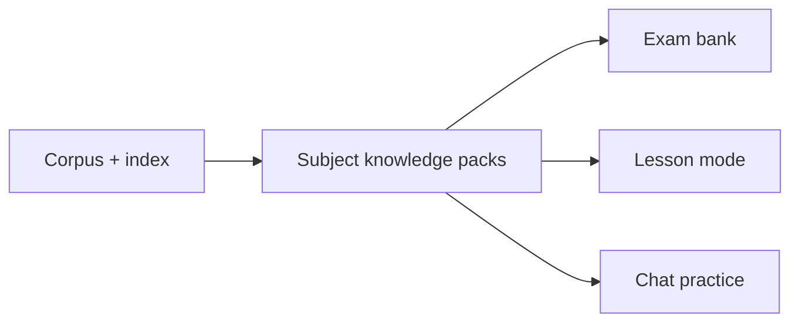
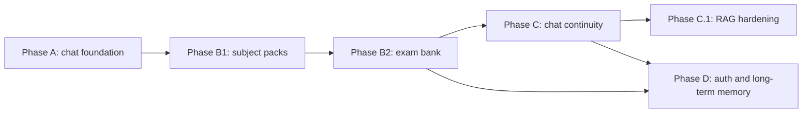

# Workplan

Last updated: 2026-11-10.

This page is the plan of record for the V2-V4 work. Update it when a phase,
boundary or ticket changes. The architecture page describes what is built; this
page describes what comes next and why.

## Current status

- V1 is shipped.
- The V2 chat foundation is delivered: LangGraph intents, verification and retry,
  guardrails, cost controls, tracing and the local eval gate. The deterministic
  PR CI gate is in place (#16); the live gate runs on the host because the
  corpus is not in git.
- The retrieval foundation #96 is closed: aggregation fixture, deterministic
  router, bounded per-book retrieval and the quota-2 measurement (multi-part
  Hit@5 0.667 to 0.778, judge 14/14, left opt-in). Routed per-book retrieval
  reaches 0.79 coverage and 0.76 completeness at equal k=7, but citation
  validity is 0.56. The retrieval-only prototype is not wired; the #105 answer
  path is wired but flag-off.
- The held-out multi-book set #106 is complete. The multi-book answer path #105
  is merged behind `OWL_MULTI_BOOK` but off: the held-out generation run gives
  coverage 0.84, citation validity 0.87 and faithfulness 0.79, so it fails two
  bars. Chat is still one-pass.
- The #105 follow-up spike is complete: retrieval-only diagnostic, ingest
  trailing-pages fix (#113), one ablation, a frozen holdout-2 and one final run.
  #113 is complete: ingest trims the next book's front matter, the corpus is
  re-ingested, the gold ids resolve and the gate baseline is re-pinned to
  `20261106T214850Z`. The final k=3 holdout passes coverage, completeness,
  citation micro-average and latency, but faithfulness, the item-level citation
  Wilson lower bound and the 3k token bar on the conservative total fail, so
  `OWL_MULTI_BOOK` stays off and the work stops.
- #97's thin slice is implemented behind `OWL_PERSONA`: persona card, DADA
  scope, scripted meta and personal replies, and the lore schema. The dev pack
  now has the five founders, the 1998/2008/2026 timeline and the Auror pathway.
  Lore-grounded answers (#118) are wired: setting notes carry `[lore:<id>]`
  citations, validated against the pack. The variant bank (#120) gives every
  scripted meta topic, the personal reply and the abstention line several
  reviewed phrasings. The real pack is published at 1.0.0; the lore eval
  follows (#97); the lesson voice is delivered (#176). Scope
  decision 2026-11-08: persona expression is tiered 0-2 - voiced grounded
  answers, then generative-within-the-record bounded by the lore pack - with
  tier 3 (invented non-canon flavor) explicitly out of scope; tiers and the
  five-professor card model are recorded in `docs/persona.md`.
- The contract/authority epic #216 is delivered: #217's design note and
  207-item frozen fixture, #219's policy/closed-fact/teaching gates, #222's
  five-card registry and subject fixtures, #218's typed citations and
  cross-type checker, #220's fact IDs/templates and #184's no-classifier
  decision. A router miss now abstains instead of entering the lesson path;
  the residual is one lesson-gap item in 207, and the five-subject fixture is
  55/55.
- The academy frontend surface has shipped: `web/` deployed on Cloudflare
  Pages - the gate, the cloister with five identified venues, live chat
  against `/ask/stream` with citation chips and in-world limit copy, the
  served exam room, session-scoped paper history and the cloister
  noticeboard, an about page stating real versus demonstration versus not
  built, and the wizard-hat identity. The venue reads `GET /v1/subjects` for
  the published pack and the live lesson/persona flags, and keeps the static
  status for open/soon; a statically open department with no pack stays on
  corpus chat with a note (#172, PR #173). Frontend follow-ups are contract-gated:
  the served exam client is wired (#193), session-scoped records are server-side
  (#206); cross-device records need #35; starter prompts are #162/#163.
- The deterministic CI gate is merged; #74 and #75 follow. #107 is deferred.
- The Lexicon canon index (#125-#128) is the feed for the B1 packs: an
  item/concept-to-chapter mapping harvested as structure only from
  hp-lexicon.org, resolved to chunk candidates in our index. The plan of
  record is `docs/lexicon-canon-index.md`. The chain has landed: the #125
  spike merged as PR #130, the #126 full harvest as PR #148 (4,993 entries
  plus all 199 novel chapters, 22,797 valid books edges, 3 flagged broken-href
  edges, 3 page failures, all site meta pages; results and the chapter-title
  cross-check are in the plan doc's Harvest results) and the #127 resolver as
  PR #159 (19,747 canon edges joined and resolved to 22,611 retained chunk
  candidates - id + text hash + span, in-pool, 0 integrity failures enforced
  by the build itself, 0 skipped urls - with agreement labels and the sidebar
  disagreement queue recorded; see the Resolver results section). The
  resolver's spot-check is machine-checked and recorded; the human read of the
  sampled quotes was not recorded before that merge, so the criterion stays
  automated-met / human-pending and carried into the five pack authoring
  reviews. #128 (pack wiring: concept seeding, reference and source-ref
  prefill, chapter-to-subject lesson table) has all five O.W.L. packs published
  at 1.0.0; reference prefill and queue reporting remain; the #87 pack schema
  and validator landed with PR #153.
- The served exam paper (#193) is built; all five packs and all five exam banks
  1.0.0 are delivered, mixed-scope lesson answers are delivered (#177, PR #199),
  and the answer path is settled, and the lesson voice is delivered (#176). The bank blueprint (#188)
  fixes a target of 25 MCQ and 25 short-answer items. The bank schema, validator
  and SQLite import are in #189, the DADA bank 1.0.0 is published in #190, the
  Charms bank 1.0.0 is published in #213, Potions in #228, Transfiguration in
  #230 and Herbology in #231; the hybrid grader is built in #192, the bank eval
  and judge calibration are recorded in #191, and served attempts are in #193.

## Product shape

Two surfaces share one retrieval core and one subject knowledge layer.



Subject knowledge packs are the grounded source of truth for exam generation
and lessons. The global hybrid index remains the retrieval layer for chat. A pack
is a versioned, validated set of subject materials, each linked to source chunks.

| Surface | Runtime | Persistence | Authority |
|---|---|---|---|
| Chat | online, streamed | stateless by default; opt-in process-local threads (#30) | formative |
| Exam bank | static content, online serving | database | authoritative |

Chat intents are answer, practice and feedback. Chat practice and feedback are
ephemeral and formative. They are not a formal paper and not an official score.

The exam bank is separate. Papers are generated offline, validated, versioned and
stored. Objective answers are scored deterministically. Free-text answers are
judged by a pinned LLM against the stored rubric and evidence. Totals and score
bands are deterministic.

## Phase A: V2 chat foundation

Status: delivered, except the deploy hardening in #74 and #75. #214 added
the post-deploy guard; the deterministic CI gate is in place.

| Ticket | Scope |
|---|---|
| #80 | Bedrock Converse Llm, LangGraph chat graph, answer/practice/feedback router, SSE |
| #81 | Chat verification and bounded retry: deterministic verify, one extra draft |
| #79 | Retrieval lexical, abstention, deadline, fabrication checks: tokenizer measured (stemming rejected), floor pinned at 0, /ask deadline, novel-entity signal |
| #82 | Agent observability: request spans, injection guard, close-out docs; intent routing measured and rejected, flag off |
| #88 | Cost controls: per-session and per-IP caps, token budget, exact cache, usage accounting, graceful degradation |
| #77 | Closed as superseded; the remaining work is #74 and #75 |

Exit criteria:

- the chat graph runs end-to-end with a defined state schema;
- the router classifies answer, practice and feedback on a fixture;
- tokens stream over SSE;
- the eval gate passes against the pinned baseline;
- one in-region Bedrock model is probed;
- a burst request hits the configured rate limit;
- a repeated question is served from the exact cache;
- usage and estimated cost are logged per request;
- the spend guard degrades chat without taking exam serving down.

Chat remains stateless in this phase. A request starts from a fresh state and
ends with one answer, practice question or feedback response.

## Phase A2: Multi-book answer path

Status: time-boxed spike complete. The flag-off path is merged. The k=3
configuration improved coverage and cost, but faithfulness, the item-level
citation Wilson lower bound and the 3k token bar miss the pre-registered bars,
so `OWL_MULTI_BOOK` stays off. There is no second cycle.

| Ticket | Scope |
|---|---|
| #106 | Held-out multi-book set, written before tuning (complete) |
| #105 | Per-book extraction, merge, one synthesis, coverage statement, flag wiring (complete, flag off) |
| #113 | Ingest: drop trailing next-book front matter from the previous chapter (complete) |
| #118 | Lore-grounded answers: `[lore:<id>]` citations and validation |

Held-out generation (`20261106T110000Z`, per-book k=15, final top-k 7): book
coverage 0.84, entity completeness 0.84, answer-text coverage 0.81, citation
validity 0.87 on the 14 synthesis items, faithfulness 0.79 on those items,
p50 9.6s, p95 14.3s, about $0.025 per 15 items. Coverage and completeness pass;
citation validity (0.87) and faithfulness (0.79 against a 0.93 baseline) do not.
The remaining defect is extractor precision: a chunk that shares a keyword with
the question can be quoted as evidence, and front-matter chunks could be
retrieved before #113. The 8-call fan-out also costs about 12x a single-pass
answer, which caps the path at roughly 14 questions per day at the default token
budget.

The final k=3 run (`20261106T233126Z`) reached coverage 0.88, completeness 0.88,
citation validity 0.93 on the 14 synthesis items, faithfulness 0.79, p95 22.9s
and $0.0095. It passes coverage, completeness, the citation micro-average and
latency. Faithfulness (Wilson lower 0.52), the item-level citation Wilson lower
bound (0.60) and the 3k token bar (4.7k total / 3.8k input per multi-book item)
fail, so the flag stays off.

The bounded cycle, in order:

1. Retrieval-only diagnostic on the current index: per-book hit@1/3/5/7/15 and
   the score distribution, no generation tokens. Complete: hit@1 0.82, hit@3
   0.95, hit@5 0.96, hit@7 0.98, hit@15 0.98; one miss (`agg08` book 4).
2. Fix #113, re-index, audit the one gold id in a last chapter (`s07` to
   `b2-c18-0025`), re-run and re-pin the gate baseline. Complete: run
   `20261106T214850Z`, gate PASS.
3. Ablate per-book k in {1, 3, 5} crossed with selection in {top-1 plus floor,
   batched top-3 call, per-book call}, plus k=15 per-book as a control. Develop
   fixture only. Complete: k3-book had the best coverage and completeness
   (0.83/0.79) and tied the best faithfulness (0.70); k1-batch was cheapest but
   below the coverage bar; k15-book was the most expensive and not the best. The
   final holdout run uses k3-book.
4. Freeze holdout-2 at 20 items and pre-register the rule: coverage at least
   0.80, citation validity at least 18/20 with a Wilson lower bound of 0.80,
   faithfulness at least 0.88 with a lower bound of 0.70, at most 3k tokens per
   item and p95 under 30s. Boundary results do not round. Complete: the fixture
   was frozen before tuning. The citation bar is unsatisfiable at 95%: 18/20 is
   about 0.70 and 20/20 about 0.84, so the faithfulness bar decides.
5. One final run. If it passes, enable behind the flag with a canary. If not,
   keep the flag off, commit the negative record, and continue with #97 and #16.
   Complete: run `20261106T233126Z` passes coverage, completeness, the citation
   micro-average and latency, but faithfulness is 0.79 (Wilson lower 0.52), the
   item-level citation Wilson lower bound is 0.60, and tokens per multi-book
   item are 4.7k total / 3.8k input. The flag stays off and the work stops.

Do not tune prompts on the held-out set, and do not add a second cycle.

Exit criteria:

- the held-out set is frozen before the path is tuned;
- the path is wired behind a flag for `multi_book` questions only;
- coverage is at least 0.75 and completeness at least 0.70;
- citation validity after synthesis is at least 0.90;
- faithfulness is no worse than the baseline;
- simple and named slices do not regress;
- latency and spend fit the chat budget;
- the gate passes and a run record is committed.

Caps: seven map calls, fan-out 4, up to 15 candidates per book, one extraction per book, one synthesis, final top-k 7.

## Cost and abuse controls

Chat is the variable-cost surface. Exam content is mostly fixed and offline;
grading adds one judge call per attempt for the free-text answers. Before user
growth, cap chat.

Defaults, configurable with `OWL_` settings:

| Limit | Anonymous | Signed in |
|---|---:|---:|
| Chat messages per minute | 10 | 30 |
| Chat messages per day | 100 | 500 |
| Concurrent chat requests | 2 | 4 |
| Exam attempts per day | 3 | 5 |

Token caps:

- maximum output per chat answer: 512 tokens;
- maximum evidence: 5 chunks for a single-pass answer, 7 for the multi-book path;
- maximum history: 6 turns or 2,000 tokens, then a rolling summary;
- hard `max_tokens` on every provider call.

Cost controls:

- exact answer cache keyed by normalised question, index hash and prompt version;
- optional semantic cache for corpus-only answers, never personalised answers;
- usage accounting for input tokens, output tokens, model, intent, latency and
  cache hit;
- daily and monthly spend guard with 50 and 80 percent alerts;
- at the hard cap, degrade chat gracefully while exam serving stays up;
- duplicate detection and a CAPTCHA or proof-of-work after a threshold.

Ticket #88 covers this work. Auth is not a dependency; anonymous limits use a
signed session cookie plus IP. When #35 lands, move the limits to `user_id`.

## Phase B: Subject packs and exam bank

Status: all five O.W.L. packs delivered; the five banks 1.0.0 are
published, the hybrid grader is built, the DADA bank eval and judge calibration
are recorded (#191), and served attempts are built (#193).

Phase B has two parts. B1 builds the subject knowledge packs. B2 builds the exam
bank and hybrid grader on top of them.

### B1: Subject knowledge packs

Status: schema and validation merged on #87 (PR #153:
`app/knowledge/taxonomy.py`, `materials.py`, `packs.py`, `OWL_SUBJECTS_PATH`,
23 tests): the 12-subject taxonomy, Topic/Concept/Material/SourceRef/
ReferenceLink records, the `data/subjects/<subject>/` layout, the
deterministic corpus-join validator and the rebuild fingerprint. The
chapter-to-subject lesson tables for the five O.W.L. pilots are approved and
compiled at `config/lessons/` (2026-11-08; extended 2026-11-10). The DADA pilot pack is
authored, reviewed and published: 25 materials, 21 concepts, 4 topics,
version 1.0.0, fingerprint `e7139cbcc23eaa5c`, and `GET /v1/subjects`
serves published packs. The pack validation record is
`docs/packs/dada-1.0.0.md`. The Charms pack is published at 1.0.0: 50 materials, 49 concepts, 7 topics,
fingerprint `12e1ee2fe077a004`; the record is `docs/packs/charms-1.0.0.md`.
Potions (34/34/6), Transfiguration (34/29/6) and Herbology (33/31/6) are also
published at 1.0.0 with records under `docs/packs/`. Remaining on #87:
reference prefill, queue reporting and coverage maintenance (#128). The canon-index coverage summary is `scripts/lexicon_report.py`;
per-subject pack coverage remains part of #87.

Lesson mode's stateless first slice (#166) answers from the pack behind
`OWL_LESSON_MODE`: the selector embeds the material texts in memory at startup,
the answer cites `[mat:<id>]` and resolves the materials' book `source_refs`.
The measured corpus answer path is unchanged while the flag is off.

A pack is the single source of truth for one O.W.L. subject. Exam generation
reads from packs; lesson mode reads from packs first and may use a labelled
corpus fallback. Neither uses free model memory.

The taxonomy covers Astronomy, Charms, Defence Against the Dark Arts, Herbology,
History of Magic, Potions, Transfiguration, Ancient Runes, Arithmancy, Divination,
Care of Magical Creatures, and Muggle Studies, at O.W.L. and N.E.W.T. tiers.

| Record | Purpose |
|---|---|
| `Subject` | one of the 12 O.W.L. subjects |
| `Topic` | subject topic, for example "Counter-jinxes" |
| `Concept` | spell, character, event, definition or procedure |
| `Material` | grounded explanation or passage, with kind, canonical text, canon tier, canon scope and review status |
| `SourceRef` | chunk id, book, chapter, quote, text hash and index hash |
| `ReferenceLink` | optional secondary source, for example a Lexicon entry, with title, URL and access date |
| `Pack` | version, status, index hash, build time and coverage summary |

Rules:

- every material has at least one source ref;
- every source ref resolves to an existing chunk with a matching text hash;
- every generated exam question and pack-backed lesson section must cite a
  material id and a source ref; a labelled off-pack lesson section cites book
  chunk ids;
- a pack rebuild is reproducible from its manifest;
- source text lives in `/data`, not in git.

Source policy:

- `source_refs` are the canonical source: book chunks with matching text hashes.
- `references` are secondary: a Lexicon entry, a wiki page or an essay. They are
  discovery and cross-check aids, not the truth of the pack.
- do not bulk-scrape or copy secondary prose verbatim. The Lexicon terms allow
  research and fan projects, require attribution and a link, prohibit
  republishing, and ask for permission outside fair use.
- record `canon_scope` as `books`, `films` or `games`. Exam and lesson packs use
  `books` by default; a film-only fact is excluded or marked secondary.
- record `review_status` and confidence so an unreviewed material cannot be
  published.

Canon tiers:

| Tier | Sources | Use in OWL core |
|---|---|---|
| Primary | the seven Harry Potter novels | exam-gradable; the only `source_refs` |
| Secondary | Rowling companion books, for example Quidditch Through the Ages | optional further reading, not exam-gradable in v1 |
| Tertiary | Rowling interviews, Pottermore, Cursed Child | optional metadata, not exam-gradable |
| Excluded | films, games, fan works | discovery only, never source refs |

The seven novels are the only exam-gradable canon. If a subject has thin book
coverage, the coverage report shows it; the generator does not fill the gap with
secondary or film material.

### Pilot order: the Auror track

The first career path is Auror. This is canon-grounded and gives the packs a
clear priority order.

`OP29` gives the requirements:

- a minimum of five N.E.W.T.s, with nothing below Exceeds Expectations;
- a high standard in Defence Against the Dark Arts;
- McGonagall advises Transfiguration, Charms and Potions; Potions and antidotes
  are described as essential study for Aurors;
- character and aptitude tests, a background check, and three further years of
  training after Hogwarts.

Pilot order:

1. Defence Against the Dark Arts;
2. Charms;
3. Transfiguration;
4. Potions;
5. a fifth subject chosen by the user, not fixed by canon.

Notes:

- a fifth N.E.W.T. is required, but canon does not name one specific fifth
  subject for every Auror candidate;
- O.W.L. entry to N.E.W.T. classes is generally Exceeds Expectations or higher;
- Potions is teacher-specific in the books: Snape asks for Outstanding in
  `OP29`, while Slughorn accepts Exceeds Expectations in `HBP6`. Do not hardcode
  one threshold without recording the context.

DADA pack scope for the first pilot:

- defensive spells, counter-jinxes and counter-curses;
- dark creatures and how to handle them;
- the Unforgivable Curses and why they are illegal;
- Dementors, the Patronus Charm and defensive theory;
- duelling, shielding and scenario response;
- key practitioners and events that illustrate the defence.

The DADA paper should use theory questions plus a written practical simulation.
It should not claim to test actual spellcasting.

Example material record:

```json
{
  "material_id": "dada.counter-jinx.01",
  "subject": "dada",
  "topic": "dada.counter-jinxes",
  "concept": "dada.counter-jinx",
  "kind": "spell",
  "text": "original grounded explanation shown to the generator",
  "canon_tier": "primary",
  "canon_scope": "books",
  "review_status": "reviewed",
  "source_refs": [
    {
      "chunk_id": "b3-c10-0036",
      "book": 3,
      "chapter": 10,
      "quote": "the exact supporting passage",
      "text_hash": "…",
      "index_text_hash": "230bf8b2ab9af9d5"
    }
  ],
  "references": [
    {
      "title": "Summoning Charm",
      "url": "https://www.hp-lexicon.org/magic/summoning-charm/",
      "publisher": "The Harry Potter Lexicon",
      "accessed": "2026-11-05"
    }
  ]
}
```

Tickets:

| Ticket | Scope |
|---|---|
| #125 | Lexicon canon index spike: citation grammar, page parsers, sample crawl (complete, PR #130) |
| #126 | Lexicon harvester: discovery, polite cached fetch, parse to gitignored JSONL |
| #127 | Lexicon resolver: buckets, forward/reverse join, chunk candidates, coverage report |
| #128 | Wire the canon index into pack concept seeding and source-ref prefill |
| #87 | Subject taxonomy, material records, source refs, pack build and validation |
| #38 | Exam data model, question types, rubric, evidence snapshots, attempts |

The item/concept-to-book index that seeds and grounds the packs is built from
The Harry Potter Lexicon. The harvest, parse and resolve pipeline is planned in
`docs/lexicon-canon-index.md` and ticketed as #125 (spike), #126 (harvester),
#127 (resolver) and #128 (pack wiring).

B1 exit criteria:

- the taxonomy covers all 12 O.W.L. subjects and both tiers;
- Defence Against the Dark Arts is fully populated and validated;
- every material resolves to an existing chunk with a matching text hash;
- every material has at least one source ref;
- only the seven novels are marked primary and used as exam-gradable source refs;
- a rebuild is reproducible from the pack manifest.

### B2: Exam bank

Status: all five subject banks 1.0.0 published (#190, #213, #228, #230,
#231); hybrid grading built (#192); the DADA bank eval and judge calibration
are recorded (#191) and the other four banks have published validation
records; served attempts built (#193).

A paper is 10 questions: 6 MCQ at 3 marks and 4 short answers at 8 marks, 50
marks total. That is long enough to feel like a paper and short enough to finish
for fun. The first bank has no long answers.

| Type | Scored by |
|---|---|
| `mcq` | deterministic matcher |
| `short_answer` | pinned LLM judge against the stored golden answer and rubric |
| `long_answer` | not in the first bank; future extension |

### Exam format blueprint

The books describe the O.W.L. experience, not a fixed paper blueprint. The
format spec therefore separates canon from adaptation.

Canon anchors:

- `OP31` - the O.W.L. chapter: theory paper plus separate practical for
  applicable subjects, external examiners, anti-cheating charms, one score per
  subject;
- `HBP5` - results and the O/E/A/P/D/T grades; the letters expand as
  Outstanding, Exceeds Expectations, Acceptable, Poor, Dreadful and Troll
  (O-E-A pass, P-D-T fail).
- `OP12` and `OP29` - why the exams matter and how they affect careers;
- the Lexicon O.W.L. page and event page as indexes to those chapters.

Canon constraints:

- one score per subject, even when theory and practical are separate;
- pass grades O, E, A; fail grades P, D, T;
- written papers in exam conditions, with anti-cheating measures;
- practical exams for applicable subjects;
- exams at the end of fifth year, over roughly two weeks;
- external examiners from the Wizarding Examinations Authority.

Adapted for this product:

- 10 questions per subject paper, not a full two-week timetable;
- 50 questions pre-generated per subject (25 MCQ and 25 short answer), randomly
  selected for each attempt;
- fixed marks and duration;
- a practical section written as a simulation: incantation, wand movement,
  intended effect and counter-measure, not actual spellcasting;
- one subject at a time, selected by the user.

Every format record stores `canon_basis`, `fidelity` (`canon` or `adapted`) and
`inference_notes`. The UI must not claim an adapted paper is the exact paper from
the books.

Tickets:

| Ticket | Scope |
|---|---|
| #39 | Offline question generator and validator |
| #41 | Hybrid grader: deterministic objective scoring plus LLM rubric judge |
| #42 | Static exam endpoints and attempt submission (built in #193; per-user attempt history follows #35) |
| #40 | Exam and grading evaluation |

The DADA bank line is #187 (sub-issues #188-#193): 25 MCQ and 25 short-answer
items, 50 in total. The blueprint is `docs/exams/dada-bank-blueprint.md`. The
Charms bank line is #213 on the same schema and grader; it publishes
`charms-1.0.0` and opens the Charms venue.

Exit criteria (met by #190-#193):

- a validated 50-item bank is stored (25 MCQ and 25 short answer);
- a paper is sampled per attempt without a model call;
- every question has a rubric, maximum marks, evidence snapshot and model answer;
- a paper can be served without a model call;
- an attempt can be submitted and graded;
- objective questions are scored deterministically;
- free-text answers are judged once per attempt with per-question structured output;
- invalid judge output is retried once and then flagged, never silently zeroed;
- totals and bands are deterministic;
- an owner-reviewed calibration set (AI-proposed marks adopted by the owner)
  reports score agreement and mean absolute error
  (`docs/runs/2026-11-09-191-dada-bank-eval.md`).

Do not add a request-time `/generate-exam` endpoint. Generation is a batch job.

## Phase C: Chat continuity

Status: short-term memory delivered (#30); continuous lesson mode remains (#43).
The active gate is RAG hardening (#247), because the lesson/chat quality claim
is ahead of the measured evidence.

This is the continuous professor experience. It needs short-term memory, not
user accounts.

| Ticket | Scope |
|---|---|
| #30 | Delivered: threads, checkpointer, messages in state, deterministic follow-up resolver, bounded conversation context |
| #43 | Lesson mode on top of the continuous chat graph |

Exit criteria:

- a thread id persists a conversation across requests;
- "who trained him?" resolves to the right entity;
- recent turns and a rolling summary fit a token budget;
- the professor persona is consistent across a thread;
- lesson mode can teach a topic and use practice questions as checkpoints;
- pack-backed lesson sections cite a subject material and a source ref; an
  off-pack section is labelled and cites set-text chunk ids.

Anonymous threads are enough here. Auth is not a dependency.

## Phase C.1: RAG hardening

Status: #248 delivered; #249-#253 active. This is the RAG side of lesson and
chat. It is not a new product surface and it does not wait on auth or exam mode.

The baseline is `docs/runs/2026-11-12-248-rag-eval-foundation.md`: 62 lesson
items and 36 multi-turn turns. Lesson citation validity is 1.0000, but
faithfulness is 2/30. Multi-turn query accuracy is 0.9444, mode accuracy 0.8611,
citation accuracy 0.5455, false refusal 0.0909, comparison accuracy 0.0833, and
referral target accuracy 0.0000 because the cross-subject contract is #253. The
baseline is pinned at `eval/results/rag-baseline.json`; the gate is
`scripts/run_rag_eval.py --check` or `run_eval.py --rag --check`.

The earlier live probes found a false refusal on "How do I defeat a Boggart?",
a cross-subject abstain on "what about Avifors?", and an implicit follow-up that
never reached generation. The new fixture records the latter two as baseline
gaps.

| Ticket | Scope |
|---|---|
| #247 | Epic: RAG hardening for lesson and chat |
| #248 | Delivered: lesson and multi-turn evaluation foundation, baseline and gate |
| #249 | Context-aware retrieval for follow-up turns |
| #250 | Lesson false refusals from lexical coverage |
| #251 | Claim-level citation binding for chat and lesson |
| #252 | Multi-part retrieval, decomposition and reranker tuning |
| #253 | Cross-subject concept awareness and professor referral |

Exit criteria:

- the lesson and multi-turn fixtures are committed, frozen with hashes and gated
  by `scripts/run_rag_eval.py --check` (also `run_eval.py --rag --check`);
- the P0 fixes are measured against a committed baseline, not against the older
  single-turn CSV, with a `docs/runs/` record and a Runs-table row;
- a false refusal and a wrong referral are diagnosable from the trace;
- the existing retrieval, abstention, faithfulness and routing slices do not
  regress;
- cross-subject awareness is a referral contract, not multi-pack teaching: the
  professor knows the concept index and the faculty lore, not another subject's
  material;
- `docs/routing-contracts.md` carries the fourth contract and the provenance
  residual, and `docs/architecture.md` carries the referral route;
- #253 owns the referral contract and the structured payload; #195 L4 consumes
  it and does not redefine it.

## Phase D: V4 identity and long-term memory

Status: optional, last phase. Start only if the exam bank and chat continuity are
working.

| Ticket | Scope |
|---|---|
| #35 | Google OIDC, users, sessions, ownership checks, rate limiting |
| #44 | Progress tracking and weak-topic surfacing |

Long-term memory includes:

- chat threads and messages per user;
- exam attempts and responses per user;
- a derived learner profile: weak topics, recent activity, preferences;
- retention, export and delete rules.

Exit criteria:

- a signed-in user can access only their own threads and attempts;
- anonymous access policy is explicit;
- Google tokens are not stored;
- users can delete their data;
- rate limits are enforced;
- weak topics are derived from stored attempts, not guessed from one prompt.

## Dependency graph



Phase C does not require Phase D. Phase D depends on both B2 and C because it
persists exam attempts and chat history. Phase C.1 is a quality gate inside
Phase C; it does not block Phase D.

## Ticket map

### Now - RAG hardening

| Ticket | Scope | Milestone |
|---|---|---|
| #247 | Epic: RAG hardening for lesson and chat | V3.1 - RAG hardening |
| #248 | Delivered: lesson and multi-turn evaluation foundation, baseline and gate | V3.1 - RAG hardening |
| #249 | Context-aware retrieval for follow-up turns | V3.1 - RAG hardening |
| #250 | Lesson false refusals from lexical coverage | V3.1 - RAG hardening |
| #251 | Claim-level citation binding for chat and lesson | V3.1 - RAG hardening |
| #33 | Minimal dashboard over `/v1/metrics` (blocked on metric definitions) | V3 - Product |
| #128 | Pack wiring: reference prefill and coverage maintenance (needs private data) | V3 - Product |

### Next - complete the loop

| Ticket | Scope | Milestone |
|---|---|---|
| #252 | Multi-part retrieval, decomposition and reranker tuning | V3.1 - RAG hardening |
| #253 | Cross-subject concept awareness and professor referral (owns the referral contract; #195 L4 reuses it) | V3.1 - RAG hardening |
| #43 | Thread-based continuous lesson mode | V3 - Product |
| #44 | Progress tracking and weak topics | V3 - Product |
| #35 | Auth, per-user history and limits | V3 - Product |

### Later - hardening

| Ticket | Scope | Milestone |
|---|---|---|
| #195 | Librarian: sixth, non-teaching door for history and referral (L4 reuses #253's referral contract) | V3 - Product |
| #74/#75 | EBS data volume and GitHub OIDC | V2 - Deepening |

### Icebox

| Ticket | Scope | Milestone |
|---|---|---|
| #107 | Quota 3, per-sub-query rerank, top-k 8 | Future / Backlog |
| #8 | Embedding cache (rerank cache is already delivered) | Future / Backlog |
| #14 | Closed-book control | Future / Backlog |
| #24 | Perturbation probes | Future / Backlog |
| #27 | Answer sufficiency check beyond the bounded retry | Future / Backlog |
| #34 | Semantic cache | Future / Backlog |

### Delivered

| Area | Tickets |
|---|---|
| Chat foundation | #80, #81, #82, #88, #79, #23, #73, #63, #29, #31, #32, #22 |
| Verification | #28 |
| Eval harness | #9, #10, #12 |
| Retrieval foundation | #96, #70, #71, #72, #78 |
| Held-out set | #106 |
| Multi-book spike | #105 (flag off) |
| Ingest | #113 |
| CI gate | #16 |
| Frontend surfaces | #132, #134, #135, #136, #137, #141, #143, #145, #157 |
| Lesson mode and persona | #120, #166, #168, #176, #177 (PR #199; the #97 thin slice is delivered, #97 stays open for the remaining persona work) |
| Venue fallback | #172 (PR #173) |
| Deploy hardening | #170, #174 (PR #175), #214 (deploy guard) |
| Contract and authority routing | #216, #217, #218, #219, #220, #222, #184 |
| Subject banks | #190, #213, #228, #230, #231 |
| Attempt history | #206 |
| Docs refresh | #185 |
| Starter prompts | #162, #163 |
| Privacy and retention | #180 |
| Browser E2E and accessibility | #179 |
| Versioned chat aliases and OpenAPI | #181 |
| Short-term chat continuity | #30 |
| Latency and cost metrics | #19 |
| Open trackers (work delivered, ticket open) | #178, #187, #38-#42, #182 |

## Backlog policy

- Now is the final-push set: finish it before pulling from Next.
- Next is the product-complete path; do not start it until the Now set is closed.
- The Icebox is research and optional experiments, not a delivery commitment.
- A delivered or superseded ticket is closed with a link; nothing is deleted.
- An active ticket needs a `Done when` and a verification step.

The #216 epic is delivered; #30, #19, #181 and #248 are delivered. The active
work is the RAG hardening line (#249-#251) plus #33 and #128. Exam mode is
delegated to a separate agent and is not part of this workplan's active set.
The remaining Now items are #249-#251 and the two blocked product tickets;
Next is #252, #253, #43, #35 and #44. On the pack line, the canon index is harvested (#125, #126)
and resolved (#127 closed); #128 carries reference prefill and coverage
maintenance. The #87 schema, validator and all five 1.0.0 packs are delivered.
#16, #120, #170, #172, #174 and #127 are closed. #107 is deferred and likely
superseded by the per-book path. The courtesy note to the Lexicon is deferred to
project completion by maintainer decision.

## Decisions

| Decision | Rationale |
|---|---|
| Multi-book is a time-boxed spike, not the main line | Citation validity, faithfulness and cost miss their bars; one bounded cycle then a documented fallback |
| A new answer path gets a retrieval-only measurement and a token estimate before generation code | The multi-book path built the expensive half before the cheap diagnostic |
| Subject packs are the source of truth for exam and lesson generation | Prevents free-model memory and makes coverage auditable |
| The Lexicon is harvested as structure only, never prose, with attribution | The site's terms forbid verbatim copying and republishing; the citation facts (which chapter cites what) are the useful layer and are safe to keep locally |
| Subject membership comes from lesson-scene evidence, not from site taxonomy tags | A magictype tag says what kind of magic an item is, not which class teaches it; the books carry the curriculum fact |
| Every material has source refs | A lesson or question can always be traced to the books |
| Every generated question or lesson cites a material and source | Unsupported content is rejected before publication |
| Ten questions per paper | Good for a fun session; full-length papers are too long |
| Static content and rubric | Reproducible after the index changes |
| Evidence snapshot per question | Chunk ids alone break when the index is rebuilt |
| Hybrid grading | Objective answers do not need a judge; free text does |
| One judge call per attempt | Four short answers fit one context; per-question records keep retries and regrading auditable |
| 25 MCQ plus 25 short answer, 50 marks | A paper is six MCQ and four short answers; 50 marks gives 2 percent per mark and clean band boundaries |
| Pinned judge, temperature 0, prompt version | Makes regrading auditable |
| Judge from a different model family than the generator | Reduces self-preference bias |
| Deterministic totals and bands | The final score is not model-generated |
| Per-session/day chat caps and exact cache | Chat is the variable-cost surface |
| Anonymous threads before auth | Continuous chat without identity work |
| Memory is opt-in and process-local | A `thread_id` turns on the checkpointer; requests without one keep the exact answer cache, and a restart drops every thread so no durable chat record exists before auth |
| Threaded generation gets a bounded conversation block | The model decides follow-ups, including comparisons; the block is not evidence and is capped by the memory budget. Retrieval still uses the standalone query. The experimental multi-book path is excluded |
| Conversation provenance is not yet checked | Prior citations are stripped and the block is marked untrusted, but the citation checker only verifies membership in the current retrieval set; a model could restate a conversation fact and cite a current excerpt. Provenance-aware verification is future work |
| Measure lesson and multi-turn before changing prompts | The last full run predates the memory work, and the live probes found false refusals and unresolved follow-ups. A prompt change without a lesson and multi-turn baseline cannot be attributed or gated |
| Cross-subject awareness is a referral contract, not multi-pack teaching | The professor may know that a concept exists and who owns it, but may not teach another subject's content. A referral is a routing outcome with its own authority and citation type |
| The professor knows the concept index, not another subject's material | The index stores concept ids, titles, aliases, subject and material id, never prose. The other subject's material never enters the prompt, so the no-teaching boundary is enforceable |
| The referral payload is one contract owned by #253 | The professors and the librarian (#195 L4) return the same structured referral contract; #195 consumes it rather than defining a second shape, so the UI and the authority checks are not duplicated |
| Threaded web chats skip the exact answer cache | Continuity needs the turn stored, and a cache hit would skip the checkpoint write. The cache still serves stateless API clients; lesson mode was already uncached, and the cost is bounded by the existing per-session and per-IP limits |
| Auth and long-term memory last | Largest privacy and security surface; not needed for a usable exam |
| Model routing for practice/feedback is rejected | Mistral was cheaper and faster but lost citations and specific error naming; the flag stays off |
| Multi-book questions use a bounded map-reduce path | Per-book retrieval and extraction make coverage structural; one top-5 pass cannot represent seven books |
| Aggregation fixture scores per-book coverage, not one reference answer | A single answer hides which book was missed; coverage and completeness make the multi-book path testable |
| Strategy delegation is deterministic | Pre-retrieval scope cues plus a post-retrieval coverage check; no model call to decide the path |
| Router ships pre-retrieval first | The cue set is measured on the fixture; the coverage check belongs with the per-book path, which caps at seven map calls with a bounded fan-out |
| Per-book retrieval is measured before wiring | At equal k=7 the prototype raises coverage 0.58 to 0.79 and keeps near-misses single-hop; chat stays one-pass until extraction and synthesis land |
| The professor is an original character, not a canon one | Limits IP exposure and avoids invented quotations; the persona is tone plus reviewed meta facts, and never adds facts to a grounded answer |
| Academy papers are mcq plus short answer | Frontend review (2026-11-07, #132): the student-facing paper drops long answers; rubric judging stays available if a future paper needs it. Revisit in #41 |
| Short answers grade in one batch call against the stored key | Four short answers fit one context window; the batch response keeps per-question structured records so retry and regrade semantics survive. Revisit in #41 |
| Result records are session-scoped until auth | The server owns the attempt and grade; the signed session cookie is the ownership boundary, and the frontend reads `GET /v1/attempts`. Cross-device history waits on #35 |
| Venue art is inline SVG geometry, never raster and never academic content | The raster pipeline was blocked twice by the image provider's terms of service (#134); SVG themes with the accent tokens, costs kilobytes, stays crisp and accessible, and keeps closed departments decorative rather than invented. Raster heroes return only as owner-supplied assets |

## Evaluation

Chat keeps the existing eval gate: retrieval, abstention, generation, faithfulness.

Exam generation adds:

- subject pack coverage for the target subject and tier;
- every question cites a known material id and source ref;
- schema validity;
- evidence coverage and grounding;
- mark totals and rubric consistency;
- duplicate and near-duplicate checks;
- subject and tier coverage.

Grading adds:

- agreement with an owner-reviewed calibration set (AI-proposed marks adopted
  by the owner);
- exact and adjacent agreement;
- mean absolute error;
- per-criterion agreement;
- parse failures and retry rate;
- length and verbosity bias checks;
- judge version and prompt version in every result.

Lesson mode adds:

- every pack-backed lesson section cites a material id and source ref;
- an off-pack section is labelled and cites book chunk ids; exam generation and
  grading never consume it;
- comprehension checks use the same subject pack;
- selection precision@3 and recall@3 against expected material ids;
- scope accuracy across in-pack, mixed, off-pack and abstain;
- false refusal rate on answerable paraphrases, reported with unanswerable
  abstention so a recall gain cannot hide a safety loss;
- citation retention and faithfulness on the lesson answer, with a judged sample
  large enough to separate a real move from noise;
- citation retention counts one material per expected concept group and the
  expected corpus chunks for mixed and off-pack answers.

Multi-turn chat adds:

- retrieval-query accuracy against the expected standalone query;
- citation accuracy for the turn, one material per expected concept group;
- comparison correctness only on turns with two expected groups, so a
  single-topic first turn cannot inflate the comparison number;
- false refusal and abstention as separate denominators, plus context
  contamination on off-topic turns;
- third-topic chaining from the most recent topic, not the first.

Cross-subject referral adds:

- target subject and target professor accuracy;
- content leak: any definition or claim about the other subject;
- authority violation: another subject's `lesson:` citation;
- false referral on an in-subject term;
- false abstain on a known out-of-subject concept;
- ambiguous terms correctly clarified.

## Out of scope

- Request-time exam generation.
- Official scores from chat feedback.
- Storing Google access tokens.
- Long-term memory before the exam bank works.
- A full-length exam as the default experience.
- Publishing an unvalidated subject pack.
- Generating exam or lesson content from model memory.
- Rendering model output as HTML.

## Risks

| Risk | Mitigation |
|---|---|
| LLM judge disagrees with a human | Calibration set, pinned config, review threshold |
| Judge output is malformed | Structured JSON, schema validation, one retry, `needs_review` |
| Exam changes after reindex | Evidence snapshots and exam versions |
| Grading cost grows | One judge call per attempt, caching, objective questions where possible |
| Chat spam or runaway token use | Per-session/day caps, token caps, exact cache, spend guard |
| Subject pack drift after reindex | Source text hashes, index hash, pack version, rebuild validation |
| Question or lesson cites an unknown material | Pack validator rejects before publication |
| Thin subject coverage | Coverage report; do not publish a subject pack below the threshold |
| Auth adds privacy risk | Last phase, minimal scopes, delete/export, no token storage |
| Memory floods the prompt | Recent window plus rolling summary plus retrieval |
