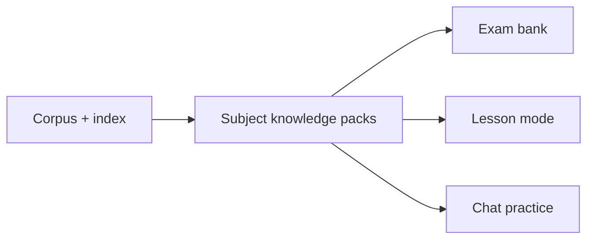
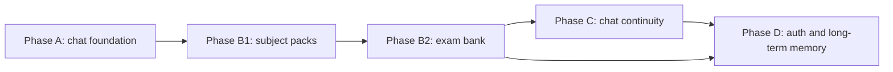

# Workplan

Last updated: 2026-11-06.

This page is the plan of record for the V2-V4 work. Update it when a phase,
boundary or ticket changes. The architecture page describes what is built; this
page describes what comes next and why.

## Current status

- V1 is shipped.
- The V2 chat foundation is delivered: LangGraph intents, verification and retry,
  guardrails, cost controls, tracing and the local eval gate. The PR CI gate is
  still #16.
- The retrieval foundation #96 is closed: aggregation fixture, deterministic
  router, bounded per-book retrieval and the quota-2 measurement (multi-part
  Hit@5 0.667 to 0.778, judge 14/14, left opt-in). Routed per-book retrieval
  reaches 0.79 coverage and 0.76 completeness at equal k=7, but citation
  validity is 0.56 and it is not wired into chat.
- Current work is #106, the held-out multi-book set, followed by #105, the
  multi-book answer path. Chat is still one-pass until #105 lands.
- #97 persona follows #105. #107 selection experiments are deferred.
- V2.5 subject packs and the exam bank follow the answer path and #97.

## Product shape

Two surfaces share one retrieval core and one subject knowledge layer.



Subject knowledge packs are the grounded source of truth for exam generation
and lessons. The global hybrid index remains the retrieval layer for chat. A pack
is a versioned, validated set of subject materials, each linked to source chunks.

| Surface | Runtime | Persistence | Authority |
|---|---|---|---|
| Chat | online, streamed | ephemeral today; threads later | formative |
| Exam bank | static content, online serving | database | authoritative |

Chat intents are answer, practice and feedback. Chat practice and feedback are
ephemeral and formative. They are not a formal paper and not an official score.

The exam bank is separate. Papers are generated offline, validated, versioned and
stored. Objective answers are scored deterministically. Free-text answers are
judged by a pinned LLM against the stored rubric and evidence. Totals and score
bands are deterministic.

## Phase A: V2 chat foundation

Status: delivered, except the deploy and CI hardening tracked in #16, #74 and #75.

| Ticket | Scope |
|---|---|
| #80 | Bedrock Converse Llm, LangGraph chat graph, answer/practice/feedback router, SSE |
| #81 | Chat verification and bounded retry: deterministic verify, one extra draft |
| #79 | Retrieval lexical, abstention, deadline, fabrication checks: tokenizer measured (stemming rejected), floor pinned at 0, /ask deadline, novel-entity signal |
| #82 | Agent observability: request spans, injection guard, close-out docs; intent routing measured and rejected, flag off |
| #88 | Cost controls: per-session and per-IP caps, token budget, exact cache, usage accounting, graceful degradation |
| #77 | Closed as superseded; the remaining work is #16, #74 and #75 |

Exit criteria:

- the chat graph runs end-to-end with a defined state schema;
- the router classifies answer, practice and feedback on a fixture;
- tokens stream over SSE;
- the eval gate passes against the pinned baseline;
- one in-region Bedrock model is probed;
- a burst request hits the configured rate limit;
- a repeated question is served from the exact cache;
- usage and estimated cost are logged per request;
- the spend guard degrades chat without taking exam serving down.

Chat remains stateless in this phase. A request starts from a fresh state and
ends with one answer, practice question or feedback response.

## Phase A2: Multi-book answer path

Status: in progress.

| Ticket | Scope |
|---|---|
| #106 | Held-out multi-book set, written before tuning |
| #105 | Per-book extraction, merge, one synthesis, coverage statement, flag wiring |

Exit criteria:

- the held-out set is frozen before the path is tuned;
- the path is wired behind a flag for `multi_book` questions only;
- coverage is at least 0.75 and completeness at least 0.70;
- citation validity after synthesis is at least 0.90;
- faithfulness is no worse than the baseline;
- simple and named slices do not regress;
- latency and spend fit the chat budget;
- the gate passes and a run record is committed.

Caps: seven map calls, fan-out 4, per-book k 1, final top-k 7, one synthesis.

## Cost and abuse controls

Chat is the variable-cost surface. Exam content is mostly fixed and offline;
grading adds a judge call per free-text answer. Before user growth, cap chat.

Defaults, configurable with `OWL_` settings:

| Limit | Anonymous | Signed in |
|---|---:|---:|
| Chat messages per minute | 10 | 30 |
| Chat messages per day | 100 | 500 |
| Concurrent chat requests | 2 | 4 |
| Exam attempts per day | 3 | 5 |

Token caps:

- maximum output per chat answer: 512 tokens;
- maximum evidence: 5 chunks;
- maximum history: 6 turns or 2,000 tokens, then a rolling summary;
- hard `max_tokens` on every provider call.

Cost controls:

- exact answer cache keyed by normalised question, index hash and prompt version;
- optional semantic cache for corpus-only answers, never personalised answers;
- usage accounting for input tokens, output tokens, model, intent, latency and
  cache hit;
- daily and monthly spend guard with 50 and 80 percent alerts;
- at the hard cap, degrade chat gracefully while exam serving stays up;
- duplicate detection and a CAPTCHA or proof-of-work after a threshold.

Ticket #88 covers this work. Auth is not a dependency; anonymous limits use a
signed session cookie plus IP. When #35 lands, move the limits to `user_id`.

## Phase B: V2.5 subject packs and exam bank

Status: next.

Phase B has two parts. B1 builds the subject knowledge packs. B2 builds the exam
bank and hybrid grader on top of them.

### B1: Subject knowledge packs

A pack is the single source of truth for one O.W.L. subject. Exam generation and
lesson mode read from packs, not from free model memory.

The taxonomy covers Astronomy, Charms, Defence Against the Dark Arts, Herbology,
History of Magic, Potions, Transfiguration, Ancient Runes, Arithmancy, Divination,
Care of Magical Creatures, and Muggle Studies, at O.W.L. and N.E.W.T. tiers.

| Record | Purpose |
|---|---|
| `Subject` | one of the 12 O.W.L. subjects |
| `Topic` | subject topic, for example "Counter-jinxes" |
| `Concept` | spell, character, event, definition or procedure |
| `Material` | grounded explanation or passage, with kind, canonical text, canon tier, canon scope and review status |
| `SourceRef` | chunk id, book, chapter, quote, text hash and index hash |
| `ReferenceLink` | optional secondary source, for example a Lexicon entry, with title, URL and access date |
| `Pack` | version, status, index hash, build time and coverage summary |

Rules:

- every material has at least one source ref;
- every source ref resolves to an existing chunk with a matching text hash;
- every generated question or lesson section must cite a material id and a
  source ref;
- a pack rebuild is reproducible from its manifest;
- source text lives in `/data`, not in git.

Source policy:

- `source_refs` are the canonical source: book chunks with matching text hashes.
- `references` are secondary: a Lexicon entry, a wiki page or an essay. They are
  discovery and cross-check aids, not the truth of the pack.
- do not bulk-scrape or copy secondary prose verbatim. The Lexicon terms allow
  research and fan projects, require attribution and a link, prohibit
  republishing, and ask for permission outside fair use.
- record `canon_scope` as `books`, `films` or `games`. Exam and lesson packs use
  `books` by default; a film-only fact is excluded or marked secondary.
- record `review_status` and confidence so an unreviewed material cannot be
  published.

Canon tiers:

| Tier | Sources | Use in OWL core |
|---|---|---|
| Primary | the seven Harry Potter novels | exam-gradable; the only `source_refs` |
| Secondary | Rowling companion books, for example Quidditch Through the Ages | optional further reading, not exam-gradable in v1 |
| Tertiary | Rowling interviews, Pottermore, Cursed Child | optional metadata, not exam-gradable |
| Excluded | films, games, fan works | discovery only, never source refs |

The seven novels are the only exam-gradable canon. If a subject has thin book
coverage, the coverage report shows it; the generator does not fill the gap with
secondary or film material.

### Pilot order: the Auror track

The first career path is Auror. This is canon-grounded and gives the packs a
clear priority order.

`OP29` gives the requirements:

- a minimum of five N.E.W.T.s, with nothing below Exceeds Expectations;
- a high standard in Defence Against the Dark Arts;
- McGonagall advises Transfiguration, Charms and Potions; Potions and antidotes
  are described as essential study for Aurors;
- character and aptitude tests, a background check, and three further years of
  training after Hogwarts.

Pilot order:

1. Defence Against the Dark Arts;
2. Charms;
3. Transfiguration;
4. Potions;
5. a fifth subject chosen by the user, not fixed by canon.

Notes:

- a fifth N.E.W.T. is required, but canon does not name one specific fifth
  subject for every Auror candidate;
- O.W.L. entry to N.E.W.T. classes is generally Exceeds Expectations or higher;
- Potions is teacher-specific in the books: Snape asks for Outstanding in
  `OP29`, while Slughorn accepts Exceeds Expectations in `HBP6`. Do not hardcode
  one threshold without recording the context.

DADA pack scope for the first pilot:

- defensive spells, counter-jinxes and counter-curses;
- dark creatures and how to handle them;
- the Unforgivable Curses and why they are illegal;
- Dementors, the Patronus Charm and defensive theory;
- duelling, shielding and scenario response;
- key practitioners and events that illustrate the defence.

The DADA paper should use theory questions plus a written practical simulation.
It should not claim to test actual spellcasting.

Example material record:

```json
{
  "material_id": "dada.counter-jinx.01",
  "subject": "defence-against-the-dark-arts",
  "topic": "counter-jinxes",
  "concept": "counter-jinx",
  "kind": "spell",
  "text": "original grounded explanation shown to the generator",
  "canon_tier": "primary",
  "canon_scope": "books",
  "review_status": "reviewed",
  "source_refs": [
    {
      "chunk_id": "b3-c10-0036",
      "book": 3,
      "chapter": 10,
      "quote": "the exact supporting passage",
      "text_hash": "…",
      "index_text_hash": "230bf8b2ab9af9d5"
    }
  ],
  "references": [
    {
      "title": "Summoning Charm",
      "url": "https://www.hp-lexicon.org/magic/summoning-charm/",
      "publisher": "The Harry Potter Lexicon",
      "accessed": "2026-11-05"
    }
  ]
}
```

Tickets:

| Ticket | Scope |
|---|---|
| #87 | Subject taxonomy, material records, source refs, pack build and validation |
| #38 | Exam data model, question types, rubric, evidence snapshots, attempts |

B1 exit criteria:

- the taxonomy covers all 12 O.W.L. subjects and both tiers;
- Defence Against the Dark Arts is fully populated and validated;
- every material resolves to an existing chunk with a matching text hash;
- every material has at least one source ref;
- only the seven novels are marked primary and used as exam-gradable source refs;
- a rebuild is reproducible from the pack manifest.

### B2: Exam bank

A paper is 10 questions. That is long enough to feel like a paper and short
enough to finish for fun. A paper may mix three question types:

| Type | Scored by |
|---|---|
| `mcq` | deterministic matcher |
| `short_answer` | deterministic accepted variants, LLM fallback for paraphrase |
| `long_answer` | pinned LLM judge against the stored rubric and evidence |

### Exam format blueprint

The books describe the O.W.L. experience, not a fixed paper blueprint. The
format spec therefore separates canon from adaptation.

Canon anchors:

- `OP31` - the O.W.L. chapter: theory paper plus separate practical for
  applicable subjects, external examiners, anti-cheating charms, one score per
  subject;
- `HBP5` - results and the O/E/A/P/D/T grades;
- `OP12` and `OP29` - why the exams matter and how they affect careers;
- the Lexicon O.W.L. page and event page as indexes to those chapters.

Canon constraints:

- one score per subject, even when theory and practical are separate;
- pass grades O, E, A; fail grades P, D, T;
- written papers in exam conditions, with anti-cheating measures;
- practical exams for applicable subjects;
- exams at the end of fifth year, over roughly two weeks;
- external examiners from the Wizarding Examinations Authority.

Adapted for this product:

- 10 questions per subject paper, not a full two-week timetable;
- 50 questions pre-generated for each subject randomly selected for each attempt;
- fixed marks and duration;
- a practical section written as a simulation: incantation, wand movement,
  intended effect and counter-measure, not actual spellcasting;
- one subject at a time, selected by the user.

Every format record stores `canon_basis`, `fidelity` (`canon` or `adapted`) and
`inference_notes`. The UI must not claim an adapted paper is the exact paper from
the books.

Tickets:

| Ticket | Scope |
|---|---|
| #39 | Offline question generator and validator |
| #41 | Hybrid grader: deterministic objective scoring plus LLM rubric judge |
| #42 | Static exam endpoints and attempt submission |
| #40 | Exam and grading evaluation |

Exit criteria:

- a validated 10-question paper can be generated offline and stored;
- every question has a rubric, maximum marks, evidence snapshot and model answer;
- a paper can be served without a model call;
- an attempt can be submitted and graded;
- objective questions are scored deterministically;
- free-text answers are judged per question with structured output;
- invalid judge output is retried once and then flagged, never silently zeroed;
- totals and bands are deterministic;
- a human-marked calibration set reports score agreement and mean absolute error.

Do not add a request-time `/generate-exam` endpoint. Generation is a batch job.

## Phase C: V3 chat continuity

Status: after the exam bank.

This is the continuous professor experience. It needs short-term memory, not
user accounts.

| Ticket | Scope |
|---|---|
| #30 | Threads, checkpointer, messages in state, rewrite node for follow-ups |
| #43 | Lesson mode on top of the continuous chat graph |

Exit criteria:

- a thread id persists a conversation across requests;
- "who trained him?" resolves to the right entity;
- recent turns and a rolling summary fit a token budget;
- the professor persona is consistent across a thread;
- lesson mode can teach a topic and use practice questions as checkpoints;
- every lesson section cites a subject material and a source ref.

Anonymous threads are enough here. Auth is not a dependency.

## Phase D: V4 identity and long-term memory

Status: optional, last phase. Start only if the exam bank and chat continuity are
working.

| Ticket | Scope |
|---|---|
| #35 | Google OIDC, users, sessions, ownership checks, rate limiting |
| #44 | Progress tracking and weak-topic surfacing |

Long-term memory includes:

- chat threads and messages per user;
- exam attempts and responses per user;
- a derived learner profile: weak topics, recent activity, preferences;
- retention, export and delete rules.

Exit criteria:

- a signed-in user can access only their own threads and attempts;
- anonymous access policy is explicit;
- Google tokens are not stored;
- users can delete their data;
- rate limits are enforced;
- weak topics are derived from stored attempts, not guessed from one prompt.

## Dependency graph



Phase C does not require Phase D. Phase D depends on both B2 and C because it
persists exam attempts and chat history.

## Ticket map

### Now

| Ticket | Scope | Milestone |
|---|---|---|
| #106 | Held-out multi-book set, written before tuning | V2 - Deepening |
| #105 | Per-book extraction, synthesis, coverage statement, flag wiring | V2 - Deepening |

### Next

| Ticket | Scope | Milestone |
|---|---|---|
| #97 | Virtual professor voice and meta intent | V2 - Deepening |
| #16 | Eval CI gate: thresholds and workflow | V2 - Deepening |
| #74 | Move `/data` to a dedicated EBS volume | V2 - Deepening |
| #75 | Replace static AWS keys with GitHub OIDC | V2 - Deepening |

### Later

| Ticket | Scope | Milestone |
|---|---|---|
| #87 | Subject knowledge packs: taxonomy, materials, source links | V3 - Product |
| #38, #39 | Exam data model, offline generation and validation | V3 - Product |
| #41, #42 | Hybrid grading and exam endpoints | V3 - Product |
| #40 | Exam and grading evaluation | V3 - Product |
| #43 | Lesson mode | V3 - Product |
| #30 | Conversation memory and follow-up rewrite | V3 - Product |
| #35, #44 | Google auth, progress tracking and weak topics | V3 - Product |
| #19 | Cost and latency p50/p95 instrumentation | V3 - Product |
| #27 | Answer sufficiency check beyond the bounded retry | V3 - Product |
| #34 | Semantic cache | V3 - Product |
| #33 | Dashboards | V3 - Product |

### Icebox

| Ticket | Scope | Milestone |
|---|---|---|
| #107 | Quota 3, per-sub-query rerank, top-k 8 | Future / Backlog |
| #8 | Embedding cache (rerank cache is already delivered) | Future / Backlog |
| #14 | Closed-book control | Future / Backlog |
| #24 | Perturbation probes | Future / Backlog |

### Delivered

| Area | Tickets |
|---|---|
| Chat foundation | #80, #81, #82, #88, #79, #23, #73, #63, #29, #31, #32, #22 |
| Verification | #28 |
| Eval harness | #9, #10, #12 |
| Retrieval foundation | #96, #70, #71, #72, #78 |

## Backlog policy

- Now holds one implementation ticket and one evaluation ticket.
- Next is committed only after Now is clear.
- Later is phase work; it is not active.
- Icebox is revisited after V2.5.
- A delivered or superseded ticket is closed with a link; nothing is deleted.
- An active ticket needs a `Done when` and a verification step.

Next work: #106 held-out set first, then #105. #96 is closed. #107 is deferred and
likely superseded by the per-book path. #97 follows #105, with a thin meta-only
path allowed earlier because it does not change the answer system prompt.

## Decisions

| Decision | Rationale |
|---|---|
| Subject packs are the source of truth for exam and lesson generation | Prevents free-model memory and makes coverage auditable |
| Every material has source refs | A lesson or question can always be traced to the books |
| Every generated question or lesson cites a material and source | Unsupported content is rejected before publication |
| Ten questions per paper | Good for a fun session; full-length papers are too long |
| Static content and rubric | Reproducible after the index changes |
| Evidence snapshot per question | Chunk ids alone break when the index is rebuilt |
| Hybrid grading | Objective answers do not need a judge; free text does |
| Per-question judge calls | Isolates failures, enables retries, keeps prompts small |
| Pinned judge, temperature 0, prompt version | Makes regrading auditable |
| Judge from a different model family than the generator | Reduces self-preference bias |
| Deterministic totals and bands | The final score is not model-generated |
| Per-session/day chat caps and exact cache | Chat is the variable-cost surface |
| Anonymous threads before auth | Continuous chat without identity work |
| Auth and long-term memory last | Largest privacy and security surface; not needed for a usable exam |
| Model routing for practice/feedback is rejected | Mistral was cheaper and faster but lost citations and specific error naming; the flag stays off |
| Multi-book questions use a bounded map-reduce path | Per-book retrieval and extraction make coverage structural; one top-5 pass cannot represent seven books |
| Aggregation fixture scores per-book coverage, not one reference answer | A single answer hides which book was missed; coverage and completeness make the multi-book path testable |
| Strategy delegation is deterministic | Pre-retrieval scope cues plus a post-retrieval coverage check; no model call to decide the path |
| Router ships pre-retrieval first | The cue set is measured on the fixture; the coverage check belongs with the per-book path, which caps at seven map calls with a bounded fan-out |
| Per-book retrieval is measured before wiring | At equal k=7 the prototype raises coverage 0.58 to 0.79 and keeps near-misses single-hop; chat stays one-pass until extraction and synthesis land |
| The professor is an original character, not a canon one | Limits IP exposure and avoids invented quotations; persona is tone and meta only, never facts |

## Evaluation

Chat keeps the existing eval gate: retrieval, abstention, generation, faithfulness.

Exam generation adds:

- subject pack coverage for the target subject and tier;
- every question cites a known material id and source ref;
- schema validity;
- evidence coverage and grounding;
- mark totals and rubric consistency;
- duplicate and near-duplicate checks;
- subject and tier coverage.

Grading adds:

- agreement with a human-marked calibration set;
- exact and adjacent agreement;
- mean absolute error;
- per-criterion agreement;
- parse failures and retry rate;
- length and verbosity bias checks;
- judge version and prompt version in every result.

Lesson mode adds:

- every lesson section cites a material id and source ref;
- no concept is taught without a pack material;
- comprehension checks use the same subject pack.

## Out of scope

- Request-time exam generation.
- Official scores from chat feedback.
- Storing Google access tokens.
- Long-term memory before the exam bank works.
- A full-length exam as the default experience.
- Publishing an unvalidated subject pack.
- Generating exam or lesson content from model memory.
- Rendering model output as HTML.

## Risks

| Risk | Mitigation |
|---|---|
| LLM judge disagrees with a human | Calibration set, pinned config, review threshold |
| Judge output is malformed | Structured JSON, schema validation, one retry, `needs_review` |
| Exam changes after reindex | Evidence snapshots and exam versions |
| Grading cost grows | Per-question calls, caching, objective questions where possible |
| Chat spam or runaway token use | Per-session/day caps, token caps, exact cache, spend guard |
| Subject pack drift after reindex | Source text hashes, index hash, pack version, rebuild validation |
| Question or lesson cites an unknown material | Pack validator rejects before publication |
| Thin subject coverage | Coverage report; do not publish a subject pack below the threshold |
| Auth adds privacy risk | Last phase, minimal scopes, delete/export, no token storage |
| Memory floods the prompt | Recent window plus rolling summary plus retrieval |
